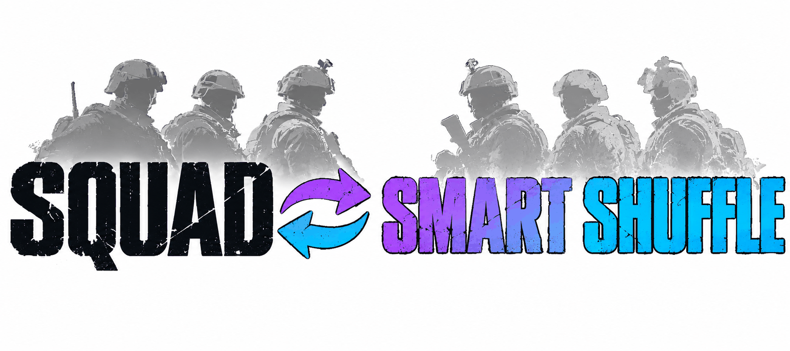
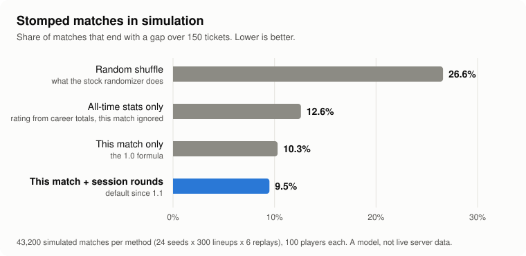

<div align="center">

<picture>
  <source media="(prefers-color-scheme: dark)" srcset="./assets/banner-dark.png">
  
</picture>

# Squad-SmartShuffle

**Smart team shuffle for Squad servers. At round end it rates every player from that match alone and splits the teams evenly, then locks team changes for one round.**

[](./LICENSE)
[](https://github.com/Miabeyefendi/Squad-SmartShuffle/releases/latest)
[](#-installation)
[](#)
[](https://github.com/Miabeyefendi)

**English** · [Türkçe](./README_TR.md) · [Español](./README_ES.md) · [简体中文](./README_ZH.md) · [Русский](./README_RU.md)

[Install](#-installation) · [Features](#-highlights) · [Usage](#-quick-start) · [Changelog](./CHANGELOG.md)

<a href="https://github.com/Miabeyefendi/Squad-SmartShuffle/releases/latest">
  
</a>
<a href="./CHANGELOG.md">
  <picture>
    <source media="(prefers-color-scheme: dark)" srcset="./assets/btn-changelog-dark.svg">
    
  </picture>
</a>

</div>

---

## ✨ Highlights

- **Rates players, not teams** - kills, wounds, deaths, damage, revives and deployables per minute, smoothed for short playtime
- **This session only** - this match plus the last few rounds of the same session, kept in memory; no database, nothing written to disk
- **Good everywhere beats good at one thing** - a weighted geometric mean, so a pure kill farmer does not outrank a well-rounded player
- **Even on every axis** - besides total strength, kill rate, damage, deaths, revives, building and kit counts (medic, vehicle crew) are split evenly
- **Squad leaders split by group** - vehicle SLs, small locked squads and open squads are each divided evenly
- **Friend groups stay together** - lock mode 2 keeps every party on one side
- **One round lock** - after a shuffle, anyone who switches (or reconnects to switch) is moved back until the round ends
- **Three routes** - a SquadJS plugin for vanilla servers, a hybrid with a small ModLoader ruleset for full scoreboard data, and a pure ModLoader Blueprint

---

## 📦 Installation

### Requirements

| Route | Needs | Server stays vanilla |
|---|---|---|
| SquadJS | [SquadJS](https://github.com/Team-Silver-Sphere/SquadJS) 4.x on the server | Yes, players download nothing |
| Hybrid | SquadJS + [ModLoader](https://steamcommunity.com/sharedfiles/filedetails/?id=3516838562) + the dump ruleset | No, modded server |
| ModLoader | ModLoader + the Blueprint ruleset | No, modded server |

### Built with


### SquadJS route

1. Download `smart-shuffle.js` from the [latest SquadJS release](https://github.com/Miabeyefendi/Squad-SmartShuffle/releases/latest).
2. Copy it into `SquadJS/squad-server/plugins/`.
3. Add the plugin to the `plugins` list in `config.json`:

```json
{
  "plugin": "SmartShuffle",
  "enabled": true,
  "autoShuffle": false,
  "lockMode": 2
}
```

4. Restart SquadJS.

<details>
<summary><b>Hybrid route (full scoreboard)</b></summary>

1. Install the SquadJS route above and set `"useScoreboardDump": true`.
2. On the server, install [ModLoader](https://steamcommunity.com/sharedfiles/filedetails/?id=3516838562) and the [SmartShuffle Workshop item](https://steamcommunity.com/sharedfiles/filedetails/?id=3835528773) (ID 3835528773).
3. In `Saved/ModLoader/ModLoader.json` (version 2) add `"/SmartShuffle/BP_SmartShuffleDump.BP_SmartShuffleDump_C": true` under `rulesets`. An older list form is converted automatically. Loading was checked on a local Windows dedicated server on 2026-11-22: ModLoader adds `BP_SmartShuffleDump` as a ruleset. The Blueprint itself is described in [`src/hybrid/BP_SmartShuffleDump.md`](./src/hybrid/BP_SmartShuffleDump.md).

When the dump lines do not arrive, the plugin falls back to the SquadJS data on its own.

</details>

<details>
<summary><b>ModLoader route (no SquadJS)</b></summary>

Build `BP_SmartShuffle` in the Squad SDK by following [`src/modloader/BP_SmartShuffle.md`](./src/modloader/BP_SmartShuffle.md),
then register it in `Saved/ModLoader/ModLoader.json`. Every Blueprint function has a tested counterpart with
the same name in `smart-shuffle.js`.

</details>

---

## 🎛️ Ready-made presets

Five ready zips for the SquadJS route, two for servers where players want to stay with friends and three that only aim for even teams. Every zip holds the same `smart-shuffle.js` (SquadJS 1.2.0), the plugin entry for `config.json` and a short `README.txt`. Only the settings differ, so you can switch presets by changing `config.json` alone. Since 1.1.0 every preset also sets `fewerMoves` to `0.1`, so a shuffle moves about a third of the server instead of half.

**Download:** [presets-v1.1.0 release](https://github.com/Miabeyefendi/Squad-SmartShuffle/releases/tag/presets-v1.1.0)

| Preset | Kind | `lockMode` | `maxPartySize` | `historyRounds` | Stomped matches (main / no synergy / volatile) | Players moved | Parties kept |
|---|---|---|---|---|---|---|---|
| `friends-small` | Friends: duos and trios | 2 | 3 | 2 | 10.6% / 10.2% / 12.4% | 36% | 60% |
| `friends-squad` | Friends: whole squads up to 6 | 2 | 6 | 4 | 11.0% / 10.8% / 12.8% | 36% | 88% |
| `quality-max` | Quality: maximum balance | 1 | - | 4 | 10.0% / 10.5% / 11.4% | 33% | - |
| `quality-session` | Quality: long session | 1 | - | 8 (12 h) | 10.4% / 10.1% / 11.7% | 33% | - |
| `quality-fresh` | Quality: tonight's form | 1 | - | 2 (3 h) | 10.4% / 10.1% / 11.7% | 33% | - |
| | Random shuffle (for comparison) | | | | 28.3% / 27.4% / 31.8% | 50% | 24% |
| | Current default (`lockMode` 2, cap 4, history 4) | | | | 10.7% / 10.7% / 12.1% | 50% | 84% |
| | Every party kept, any size (for comparison) | | | | 14.3% / 12.8% / 17.2% | 50% | 99% |

**How to pick.** Players keep asking to stay with a friend: `friends-small`. Clans and friend groups play as a whole squad: `friends-squad`. Friends do not matter and you want the most even teams: `quality-max`. The same regulars play for many hours: `quality-session`. A public server where many players come and go: `quality-fresh`.

### Preset simulation

Each preset was played in three simulated worlds, 7,200 matches each (21,600 per preset), with 100 players, 6 to 10 small parties of 2 to 4 and 1 or 2 stacks of 6 to 9 per match, the ticket model of the earlier rounds and the same session history with 20% of players new each round. A match counts as stomped when the ticket gap is over 150.

- **main:** tonight's form varies (15%) and party members play better together (party synergy 15%)
- **no synergy:** parties are not stronger together
- **volatile:** tonight's form varies twice as much (30%)

What it showed:

- All five presets cut stomped matches from about 28% (random) to 10 to 13% and move 33 to 36% of the players per shuffle instead of 50%.
- The three quality presets beat the current default by 0.3 to 0.8 points in every world.
- Keeping friends costs balance, and bigger kept groups cost more: duos and trios cost almost nothing, parties up to 6 cost about the same as the current default, keeping every stack of 7 to 9 raises stomps to 14% (17% in the volatile world). That is why no preset keeps every party.
- **Fewer moves.** The plugin picks the two sides without looking at who is where now, so it moved about half of the server at every shuffle. `fewerMoves` first swaps the side labels when that saves moves, then moves players back to their current side in pairs while the balance stays within that share of the best split. The middle ground is `0.1`: 33% of players moved and the same share of stomped matches within noise. `0.2` moves 27% but adds about 0.5 points of stomps. A split that starts from the current teams moves only 19%, but adds 0.5 to 1 point, so it was left out.
- A search from 8 starting splits was also tested and left out: a tighter score gap on paper, no fewer stomps.

These are model results, not live data.

---

## 🚀 Quick Start

Type these in the in-game **admin chat**:

```
!smartshuffle now        shuffle once at the end of this round
!smartshuffle preview    show what a shuffle would do right now, moves nobody
!smartshuffle cancel     call off the shuffle queued with now
!smartshuffle friends on keep friend groups (parties) together when shuffling, off splits them
!smartshuffle history on count each player's earlier rounds of this session, off uses only this match
!smartshuffle mss on     blend in the all-time rating from MySquadStats (needs a token), off by default
!smartshuffle auto on    shuffle at the end of every round
!smartshuffle lock 2     lock after a shuffle and keep friend groups together
!smartshuffle unlock     lift the lock for the rest of this round
!smartshuffle status     show the current settings
```

At round end the plugin moves players with `AdminForceTeamChange`, broadcasts how many were moved, and holds
the new teams until the next round ends.

Players are only moved on the end screen, right after the round ends. If the next map starts first, the shuffle stops: nobody is moved in a running match, so nobody loses a squad, kit or vehicle claim to the shuffle.

---

## 📘 Step-by-step guide

From an empty server to a working shuffle. You need a running SquadJS and admin rights on the server. No coding.

### 1. Install

Download `smart-shuffle.js` from the [latest release](https://github.com/Miabeyefendi/Squad-SmartShuffle/releases/latest) and copy it into `SquadJS/squad-server/plugins/`.

Open `SquadJS/config.json`, find the `"plugins": [` list and add this entry. Mind the comma between entries.

```json
{
  "plugin": "SmartShuffle",
  "enabled": true,
  "autoShuffle": false
}
```

Restart SquadJS. Every setting you do not write keeps its default, so this short entry is enough.

### 2. Check that it loaded

Join the server and type this in the **admin chat** (not all chat):

```
!smartshuffle status
```

You get a private message like this:

```
Smart Shuffle: auto off, lock on, friends on, history on, mss off, pending 0, locked now 0.
```

No answer? Check these in order: the file is in the `plugins` folder, the entry says `"enabled": true`, the name is exactly `SmartShuffle`, you typed in admin chat, and the SquadJS log shows no error at start.

### 3. Try it without moving anyone

In the middle of a match:

```
!smartshuffle preview
```

```
Smart Shuffle preview (this match so far): 41 of 96 would move, score gap 18% -> 1%.
```

Nobody is moved. You get a summary, and the SquadJS log lists who would go where (`Preview moves`).

### 4. Run the first real shuffle

```
!smartshuffle now
```

The server is told that teams will be balanced. When the round ends, players are moved on the end screen, before the next map loads. You get a report:

```
Smart Shuffle report: 44 moved, 0 not placed, score gap 21% -> 1%, done in 3.2 s.
```

Changed your mind before the round ends? `!smartshuffle cancel`.

### 5. Make it automatic

`!smartshuffle auto on` shuffles at the end of every round until SquadJS restarts. To keep it after a restart, set `"autoShuffle": true` in `config.json`.

### 6. Change the defaults

There are two ways. A chat command works at once and lasts until SquadJS restarts. A line in `config.json` is permanent and needs a restart. Common choices:

| I want | In `config.json` | In admin chat |
|---|---|---|
| A shuffle every round | `"autoShuffle": true` | `auto on` |
| Pure balance, friends not kept together | `"keepParties": false` | `friends off` |
| Bigger friend groups kept together | `"maxPartySize": 6` | - |
| No lock after a shuffle | `"lockMode": 0`, plus `"keepParties": true` to still keep friends | `lock off` |
| Only the match that just ended | `"historyRounds": 0` | `history off` |
| Time to read the scoreboard first | `"shuffleDelaySeconds": 15` | - |
| No messages to players | `"announceMinutes": 0`, `"warnMovedPlayers": false`, `"broadcastResult": false` | - |
| Shuffle on Invasion too | `"skipLayers": ["seed", "jensen"]` | - |
| A smaller server | `"minPlayers": 20` | - |

An entry with several changes looks like this. The full list is under [Configuration](#️-configuration).

```json
{
  "plugin": "SmartShuffle",
  "enabled": true,
  "autoShuffle": true,
  "maxPartySize": 3,
  "shuffleDelaySeconds": 15,
  "minPlayers": 30
}
```

### 7. Optional: MySquadStats rating

Off by default and experimental: in the simulation it did not improve the balance, and it has not been run against the live API yet. To try it:

1. Get a token. MySquadStats gives one to every participating server, see [mysquadstats.com/participate](https://mysquadstats.com/participate). If you already run their SquadJS plugin, it is the `accessToken` in that plugin's entry.
2. Add these two lines to the SmartShuffle entry in `config.json`:

   ```json
   "useMySquadStats": true,
   "mySquadStatsToken": "YOUR_TOKEN"
   ```

3. Restart SquadJS. `!smartshuffle status` now shows `mss on`. Players are looked up a few at a time during the match, so the rating fills in over the first minutes.

Keep the token private: do not post your `config.json` in public. `!smartshuffle mss off` turns the rating off again without a restart.

---

## 🧮 How it works

1. **Collect.** During the match the plugin counts, per player: kills, wounds dealt, deaths, damage, revives,
   deployables placed, teamkills and minutes played. A new map starts a new count; the last rounds of the session are kept in memory for the score.
2. **Score.** Each stat becomes a per-minute rate pulled toward the match average (30 minute prior), then a
   z-score squashed to 0..1, half against the whole server and half inside the player's own team. Four
   categories (KDA, Combat, Teamwork, Objective) are combined with a weighted geometric mean, with separate
   weights for squad leaders, medics and support-heavy players. Each teamkill costs 10%.
3. **Split.** Squad leaders are split first, group by group. Everyone else goes greedy to the weaker side, then
   pair swaps shrink the gap in total strength and in every extra dimension at once.
4. **Lock.** Lock mode 1 holds every player on the new side for one round. Lock mode 2 first moves each party
   to one side, then holds it.

In a 100 player simulation with ticket-based matches, the share of stomps (a gap over 150 tickets) dropped
from 26% with a random shuffle to 10.4% with the SquadJS formula and 9.3% with the full scoreboard (hybrid).
These numbers are without friend keeping. With parties of up to 4 kept together the SquadJS formula gives about 11%; keeping every party together, including 9 player stacks, gives about 13%.
With each player's earlier rounds of the session counted (the default), the SquadJS formula gives about 9.5%.

<p align="center">
  <picture>
    <source media="(prefers-color-scheme: dark)" srcset="./assets/sim-chart-dark.svg">
    
  </picture>
</p>

Four ways to rate the players, each tested over 43,200 simulated matches. The blue bar is the method Smart Shuffle uses by default.

---

## ⚙️ Configuration

All options go into the plugin entry in SquadJS `config.json`.

| Key | Default | What it does |
|---|---|---|
| `command` | `smartshuffle` | Admin chat command name |
| `autoShuffle` | `false` | Shuffle at the end of every round |
| `lockMode` | `2` | 0 no lock, 1 hard lock, 2 lock that keeps parties together |
| `keepParties` | follows `lockMode` | Keep parties together when shuffling, independent of the lock: `true` or `false`. Left out, it is on for `lockMode` 2 and off for 0 and 1 |
| `kitMedic` | `Medic` | Regex on the role name for medic kits |
| `kitLogistics` | empty | Regex for a logistics kit class, empty means not used |
| `kitCrew` | `Crewman\|Pilot` | Regex for vehicle crew kits; crew SLs form their own SL group |
| `lockedSquadMaxSize` | `3` | A locked squad up to this size counts as a friend squad |
| `maxPartySize` | `4` | Lock mode 2: a party up to this size stays together, a bigger one is split. 0 means no limit |
| `skipLayers` | `["seed", "jensen", "invasion"]` | Automatic shuffle skips a round whose layer name contains one of these. `!smartshuffle now` always runs |
| `minPlayers` | `40` | Automatic shuffle skips a round with fewer players. `!smartshuffle now` always runs |
| `fewerMoves` | `0` | Move fewer players. 0 is off. Above 0 more players stay on their current side and the balance gap may grow by that share. `0.1` moves about a third fewer players (50% down to 33% in simulation) with the same share of stomped matches |
| `shuffleDelaySeconds` | `0` | Seconds to wait after the round ends before players are moved (time to read the scoreboard), 0 to 25 |
| `shuffleDeadlineSeconds` | `30` | Nobody is moved later than this many seconds after the round ended, and never after the next map started |
| `announceMinutes` | `10` | While a shuffle is due, tell the server every this many minutes. 0 turns the announcements off |
| `broadcastResult` | `true` | Tell the server after a shuffle how many players were moved |
| `warnMovedPlayers` | `true` | Tell each moved player in a private message that they changed team |
| `adminReport` | `true` | Send the result (moved, not placed, score gap before and after) to the admins online |
| `historyRounds` | `4` | Also count each player's earlier rounds of this session, kept in memory only: how many rounds back. 0 means only this match. Not used on the hybrid route |
| `historyHours` | `6` | Earlier rounds older than this many hours are not counted |
| `useMySquadStats` | `false` | Experimental. Blend an all-time rating from [mysquadstats.com](https://mysquadstats.com) into the score. Needs `mySquadStatsToken` |
| `mySquadStatsToken` | empty | Access token of your server for the MySquadStats API, the one their SquadJS plugin uses. Tokens are given to participating servers on their Discord |
| `mySquadStatsWeight` | `0.15` | Share of the all-time rating in the score, 0 to 1 |
| `mySquadStatsDlc` | `vanilla` | Which MySquadStats leaderboard to read |
| `useScoreboardDump` | `false` | Hybrid route: read the full scoreboard from the server log |
| `dumpWaitSeconds` | `10` | Hybrid route: how long to wait for the dump at round end |

---

## 📖 Documentation

- [**Hybrid Blueprint recipe**](./src/hybrid/BP_SmartShuffleDump.md) - the dump ruleset and its log format
- [**ModLoader Blueprint recipe**](./src/modloader/BP_SmartShuffle.md) - the full in-game version
- [**Changelog**](./CHANGELOG.md) - what changed in each release
- [**Contributing**](./CONTRIBUTING.md) - how to send a change
- [**Security**](./SECURITY.md) - how to report a vulnerability privately

Tests: `node --test tests/squadjs/core.test.mjs`. They check the scores and teams against the reference model
and run the plugin against a fake SquadJS server.

---

## 🧭 Roadmap

- [ ] Run the SquadJS plugin on a live server and confirm the `ListPlayers` party format
- [x] Build and publish the hybrid dump ruleset on the Workshop
- [ ] Build the ModLoader Blueprint

Nothing here is a promise. This is a personal project and the list moves when my
priorities move.

---

## ❓ FAQ

<details>
<summary><b>How is this different from the stock randomizer?</b></summary>

`!randomize` shuffles at random, so strong players can still land together. This plugin rates every player from
the match that just ended and splits the teams so total strength and each kind of contribution come out even.

</details>

<details>
<summary><b>Does it keep player history?</b></summary>

No. It uses the match that just ended and, by default, each player's last 4 rounds of the same session (up to 6 hours back). These live in memory only and are gone when SquadJS restarts. Nothing is written to disk. Set `historyRounds` to 0 to use only the match that just ended.

</details>

<details>
<summary><b>Do players need to download anything?</b></summary>

Not on the SquadJS route: the plugin runs next to the server and the server stays vanilla. The hybrid and
ModLoader routes need ModLoader, which players download automatically when they join, and the server is listed
as modded.

</details>

<details>
<summary><b>Can Epic Games players join?</b></summary>

On the SquadJS route the server is unchanged, so anyone who can join it today still can. The Epic Games build of
Squad does not support mods, so the hybrid and ModLoader routes are for Steam players.

</details>

---

## 🤝 Contributing

Contributions are welcome. Read [CONTRIBUTING.md](./CONTRIBUTING.md) and
[CODE_OF_CONDUCT.md](./CODE_OF_CONDUCT.md) first. By contributing you agree to
license your work under the AGPL-3.0.

<div align="center">
<a href="https://github.com/Miabeyefendi/Squad-SmartShuffle/issues/new?template=bug_report.yml">
  <picture>
    <source media="(prefers-color-scheme: dark)" srcset="./assets/btn-report-bug-dark.svg">
    
  </picture>
</a>
<a href="https://github.com/Miabeyefendi/Squad-SmartShuffle/stargazers">
  <picture>
    <source media="(prefers-color-scheme: dark)" srcset="./assets/btn-star-dark.svg">
    
  </picture>
</a>
</div>

---

## 🙏 Credits

- [**SquadJS**](https://github.com/Team-Silver-Sphere/SquadJS) by Team Silver Sphere - the plugin host. The
  plugin uses its log events, RCON and `BasePlugin`, and follows the stock `TeamRandomizer` for moving players.
- [**ModLoader**](https://steamcommunity.com/sharedfiles/filedetails/?id=3516838562) by Jhett - loads
  rulesets on vanilla layers. [SquadJSLogger](https://steamcommunity.com/sharedfiles/filedetails/?id=3586951441),
  by the same author, showed that a ruleset can write to the server log, which the hybrid route builds on.

---

## 🛡️ Security

Found a vulnerability? Do not open a public issue. Follow the private process in
[SECURITY.md](./SECURITY.md).

---

## 📜 License

This project is licensed under the **GNU Affero General Public License v3.0
(AGPL-3.0)**, together with the supplemental terms in the [NOTICE](./NOTICE)
file. In short:

- You may use, study, modify, redistribute and even make money with this software
  for free, **as long as** you keep the complete source code available under the
  AGPL-3.0, including for any hosted, SaaS or network use (AGPL Section 13), and
  you preserve the author attribution below.
- To use this work in a closed-source or proprietary product, or to run it as a
  closed SaaS, you need a **separate written commercial license**, which may
  include a royalty or revenue share. See [NOTICE](./NOTICE), Section 8, and
  contact me.

### Attribution (required)

Per AGPL-3.0 Section 7(b), the following attribution must be preserved, visibly
and unmodified, in any copy, fork or deployment of this project:

> **Miabeyefendi (Mustafa Ihsan Albayrak)** - https://github.com/Miabeyefendi

### Disclaimer

This software is provided "as is", without warranty of any kind. You run it
entirely at your own risk and are solely responsible for your own use, including
compliance with the terms of service of any third-party platform it interacts
with. Those platforms are not affiliated with or endorsed by the author; their
names and trademarks belong to their respective owners. The author accepts no
liability for account bans, data loss or any other damages, to the maximum extent
permitted by applicable law. Full terms are in the [LICENSE](./LICENSE) and
[NOTICE](./NOTICE) files.

---

## 📬 Contact

- GitHub: [@miabeyefendi](https://github.com/Miabeyefendi)
- For commercial licensing or revenue-sharing enquiries, reach me through my
  GitHub profile.

<div align="center">
<br/>

<br/>
<sub>Built by <b><a href="https://github.com/Miabeyefendi">Miabeyefendi</a></b></sub>
</div>
