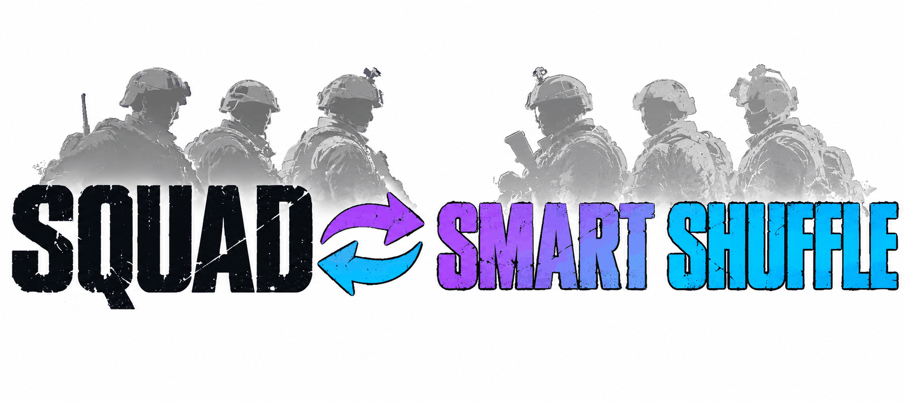

<div align="center">

<picture>
  <source media="(prefers-color-scheme: dark)" srcset="./assets/banner-dark.png">
  
</picture>

# Squad-SmartShuffle

**Smart team shuffle for Squad servers. At round end it rates every player from that match alone and splits the teams evenly, then locks team changes for one round.**

[](./LICENSE)
[](https://github.com/Miabeyefendi/Squad-SmartShuffle/releases/latest)
[](#-installation)
[](#)
[](https://github.com/Miabeyefendi)

**English** · [Türkçe](./README_TR.md) · [Español](./README_ES.md) · [简体中文](./README_ZH.md) · [Русский](./README_RU.md)

[Install](#-installation) · [Features](#-highlights) · [Usage](#-quick-start) · [Changelog](./CHANGELOG.md)

<a href="https://github.com/Miabeyefendi/Squad-SmartShuffle/releases/latest">
  
</a>
<a href="./CHANGELOG.md">
  <picture>
    <source media="(prefers-color-scheme: dark)" srcset="./assets/btn-changelog-dark.svg">
    
  </picture>
</a>

</div>

---

## ✨ Highlights

- **Rates players, not teams** - kills, wounds, deaths, damage, revives and deployables per minute, smoothed for short playtime
- **Only this match** - no database, no ratings, no Steam IDs kept; every round starts from zero
- **Good everywhere beats good at one thing** - a weighted geometric mean, so a pure kill farmer does not outrank a well-rounded player
- **Even on every axis** - besides total strength, kill rate, damage, deaths, revives, building and kit counts (medic, vehicle crew) are split evenly
- **Squad leaders split by group** - vehicle SLs, small locked squads and open squads are each divided evenly
- **Friend groups stay together** - lock mode 2 keeps every party on one side
- **One round lock** - after a shuffle, anyone who switches (or reconnects to switch) is moved back until the round ends
- **Three routes** - a SquadJS plugin for vanilla servers, a hybrid with a small ModLoader ruleset for full scoreboard data, and a pure ModLoader Blueprint

---

## 📦 Installation

### Requirements

| Route | Needs | Server stays vanilla |
|---|---|---|
| SquadJS | [SquadJS](https://github.com/Team-Silver-Sphere/SquadJS) 4.x on the server | Yes, players download nothing |
| Hybrid | SquadJS + [ModLoader](https://steamcommunity.com/sharedfiles/filedetails/?id=3516838562) + the dump ruleset | No, modded server |
| ModLoader | ModLoader + the Blueprint ruleset | No, modded server |

### Built with


### SquadJS route

1. Download `smart-shuffle.js` from the [latest SquadJS release](https://github.com/Miabeyefendi/Squad-SmartShuffle/releases/latest).
2. Copy it into `SquadJS/squad-server/plugins/`.
3. Add the plugin to the `plugins` list in `config.json`:

```json
{
  "plugin": "SmartShuffle",
  "enabled": true,
  "autoShuffle": false,
  "lockMode": 2
}
```

4. Restart SquadJS.

<details>
<summary><b>Hybrid route (full scoreboard)</b></summary>

1. Install the SquadJS route above and set `"useScoreboardDump": true`.
2. On the server, install [ModLoader](https://steamcommunity.com/sharedfiles/filedetails/?id=3516838562) and the [SmartShuffle Workshop item](https://steamcommunity.com/sharedfiles/filedetails/?id=3835528773) (ID 3835528773).
3. Add `/SmartShuffle/BP_SmartShuffleDump.BP_SmartShuffleDump_C` to the `rulesets` list in `Saved/ModLoader/ModLoader.json`. The Blueprint itself is described in [`src/hybrid/BP_SmartShuffleDump.md`](./src/hybrid/BP_SmartShuffleDump.md).

When the dump lines do not arrive, the plugin falls back to the SquadJS data on its own.

</details>

<details>
<summary><b>ModLoader route (no SquadJS)</b></summary>

Build `BP_SmartShuffle` in the Squad SDK by following [`src/modloader/BP_SmartShuffle.md`](./src/modloader/BP_SmartShuffle.md),
then register it in `Saved/ModLoader/ModLoader.json`. Every Blueprint function has a tested counterpart with
the same name in `smart-shuffle.js`.

</details>

---

## 🚀 Quick Start

Type these in the in-game **admin chat**:

```
!smartshuffle now        shuffle once at the end of this round
!smartshuffle preview    show what a shuffle would do right now, moves nobody
!smartshuffle cancel     call off the shuffle queued with now
!smartshuffle friends on keep friend groups (parties) together when shuffling, off splits them
!smartshuffle auto on    shuffle at the end of every round
!smartshuffle lock 2     lock after a shuffle and keep friend groups together
!smartshuffle unlock     lift the lock for the rest of this round
!smartshuffle status     show the current settings
```

At round end the plugin moves players with `AdminForceTeamChange`, broadcasts how many were moved, and holds
the new teams until the next round ends.

Players are only moved on the end screen, right after the round ends. If the next map starts first, the shuffle stops: nobody is moved in a running match, so nobody loses a squad, kit or vehicle claim to the shuffle.

---

## 🧮 How it works

1. **Collect.** During the match the plugin counts, per player: kills, wounds dealt, deaths, damage, revives,
   deployables placed, teamkills and minutes played. A new map clears everything.
2. **Score.** Each stat becomes a per-minute rate pulled toward the match average (30 minute prior), then a
   z-score squashed to 0..1, half against the whole server and half inside the player's own team. Four
   categories (KDA, Combat, Teamwork, Objective) are combined with a weighted geometric mean, with separate
   weights for squad leaders, medics and support-heavy players. Each teamkill costs 10%.
3. **Split.** Squad leaders are split first, group by group. Everyone else goes greedy to the weaker side, then
   pair swaps shrink the gap in total strength and in every extra dimension at once.
4. **Lock.** Lock mode 1 holds every player on the new side for one round. Lock mode 2 first moves each party
   to one side, then holds it.

In a 100 player simulation with ticket-based matches, the share of stomps (a gap over 150 tickets) dropped
from 26% with a random shuffle to 10.4% with the SquadJS formula and 9.3% with the full scoreboard (hybrid).
These numbers are without friend keeping. With parties of up to 4 kept together the SquadJS formula gives about 11%; keeping every party together, including 9 player stacks, gives about 13%.

---

## ⚙️ Configuration

All options go into the plugin entry in SquadJS `config.json`.

| Key | Default | What it does |
|---|---|---|
| `command` | `smartshuffle` | Admin chat command name |
| `autoShuffle` | `false` | Shuffle at the end of every round |
| `lockMode` | `2` | 0 no lock, 1 hard lock, 2 lock that keeps parties together |
| `keepParties` | follows `lockMode` | Keep parties together when shuffling, independent of the lock: `true` or `false`. Left out, it is on for `lockMode` 2 and off for 0 and 1 |
| `kitMedic` | `Medic` | Regex on the role name for medic kits |
| `kitLogistics` | empty | Regex for a logistics kit class, empty means not used |
| `kitCrew` | `Crewman\|Pilot` | Regex for vehicle crew kits; crew SLs form their own SL group |
| `lockedSquadMaxSize` | `3` | A locked squad up to this size counts as a friend squad |
| `maxPartySize` | `4` | Lock mode 2: a party up to this size stays together, a bigger one is split. 0 means no limit |
| `skipLayers` | `["seed", "jensen", "invasion"]` | Automatic shuffle skips a round whose layer name contains one of these. `!smartshuffle now` always runs |
| `minPlayers` | `40` | Automatic shuffle skips a round with fewer players. `!smartshuffle now` always runs |
| `shuffleDelaySeconds` | `0` | Seconds to wait after the round ends before players are moved (time to read the scoreboard), 0 to 25 |
| `shuffleDeadlineSeconds` | `30` | Nobody is moved later than this many seconds after the round ended, and never after the next map started |
| `announceMinutes` | `10` | While a shuffle is due, tell the server every this many minutes. 0 turns the announcements off |
| `broadcastResult` | `true` | Tell the server after a shuffle how many players were moved |
| `warnMovedPlayers` | `true` | Tell each moved player in a private message that they changed team |
| `adminReport` | `true` | Send the result (moved, not placed, score gap before and after) to the admins online |
| `useScoreboardDump` | `false` | Hybrid route: read the full scoreboard from the server log |
| `dumpWaitSeconds` | `10` | Hybrid route: how long to wait for the dump at round end |

---

## 📖 Documentation

- [**Hybrid Blueprint recipe**](./src/hybrid/BP_SmartShuffleDump.md) - the dump ruleset and its log format
- [**ModLoader Blueprint recipe**](./src/modloader/BP_SmartShuffle.md) - the full in-game version
- [**Changelog**](./CHANGELOG.md) - what changed in each release
- [**Contributing**](./CONTRIBUTING.md) - how to send a change
- [**Security**](./SECURITY.md) - how to report a vulnerability privately

Tests: `node --test tests/squadjs/core.test.mjs`. They check the scores and teams against the reference model
and run the plugin against a fake SquadJS server.

---

## 🧭 Roadmap

- [ ] Run the SquadJS plugin on a live server and confirm the `ListPlayers` party format
- [x] Build and publish the hybrid dump ruleset on the Workshop
- [ ] Build the ModLoader Blueprint

Nothing here is a promise. This is a personal project and the list moves when my
priorities move.

---

## ❓ FAQ

<details>
<summary><b>How is this different from the stock randomizer?</b></summary>

`!randomize` shuffles at random, so strong players can still land together. This plugin rates every player from
the match that just ended and splits the teams so total strength and each kind of contribution come out even.

</details>

<details>
<summary><b>Does it keep player history?</b></summary>

No. It only uses the match that just ended and forgets it when the next map loads. Nothing is written to disk.

</details>

<details>
<summary><b>Do players need to download anything?</b></summary>

Not on the SquadJS route: the plugin runs next to the server and the server stays vanilla. The hybrid and
ModLoader routes need ModLoader, which players download automatically when they join, and the server is listed
as modded.

</details>

<details>
<summary><b>Can Epic Games players join?</b></summary>

On the SquadJS route the server is unchanged, so anyone who can join it today still can. The Epic Games build of
Squad does not support mods, so the hybrid and ModLoader routes are for Steam players.

</details>

---

## 🤝 Contributing

Contributions are welcome. Read [CONTRIBUTING.md](./CONTRIBUTING.md) and
[CODE_OF_CONDUCT.md](./CODE_OF_CONDUCT.md) first. By contributing you agree to
license your work under the AGPL-3.0.

<div align="center">
<a href="https://github.com/Miabeyefendi/Squad-SmartShuffle/issues/new?template=bug_report.yml">
  <picture>
    <source media="(prefers-color-scheme: dark)" srcset="./assets/btn-report-bug-dark.svg">
    
  </picture>
</a>
<a href="https://github.com/Miabeyefendi/Squad-SmartShuffle/stargazers">
  <picture>
    <source media="(prefers-color-scheme: dark)" srcset="./assets/btn-star-dark.svg">
    
  </picture>
</a>
</div>

---

## 🙏 Credits

- [**SquadJS**](https://github.com/Team-Silver-Sphere/SquadJS) by Team Silver Sphere - the plugin host. The
  plugin uses its log events, RCON and `BasePlugin`, and follows the stock `TeamRandomizer` for moving players.
- [**ModLoader**](https://steamcommunity.com/sharedfiles/filedetails/?id=3516838562) by Jhett - loads
  rulesets on vanilla layers. [SquadJSLogger](https://steamcommunity.com/sharedfiles/filedetails/?id=3586951441),
  by the same author, showed that a ruleset can write to the server log, which the hybrid route builds on.

---

## 🛡️ Security

Found a vulnerability? Do not open a public issue. Follow the private process in
[SECURITY.md](./SECURITY.md).

---

## 📜 License

This project is licensed under the **GNU Affero General Public License v3.0
(AGPL-3.0)**, together with the supplemental terms in the [NOTICE](./NOTICE)
file. In short:

- You may use, study, modify, redistribute and even make money with this software
  for free, **as long as** you keep the complete source code available under the
  AGPL-3.0, including for any hosted, SaaS or network use (AGPL Section 13), and
  you preserve the author attribution below.
- To use this work in a closed-source or proprietary product, or to run it as a
  closed SaaS, you need a **separate written commercial license**, which may
  include a royalty or revenue share. See [NOTICE](./NOTICE), Section 8, and
  contact me.

### Attribution (required)

Per AGPL-3.0 Section 7(b), the following attribution must be preserved, visibly
and unmodified, in any copy, fork or deployment of this project:

> **Miabeyefendi (Mustafa Ihsan Albayrak)** - https://github.com/Miabeyefendi

### Disclaimer

This software is provided "as is", without warranty of any kind. You run it
entirely at your own risk and are solely responsible for your own use, including
compliance with the terms of service of any third-party platform it interacts
with. Those platforms are not affiliated with or endorsed by the author; their
names and trademarks belong to their respective owners. The author accepts no
liability for account bans, data loss or any other damages, to the maximum extent
permitted by applicable law. Full terms are in the [LICENSE](./LICENSE) and
[NOTICE](./NOTICE) files.

---

## 📬 Contact

- GitHub: [@miabeyefendi](https://github.com/Miabeyefendi)
- For commercial licensing or revenue-sharing enquiries, reach me through my
  GitHub profile.

<div align="center">
<br/>

<br/>
<sub>Built by <b><a href="https://github.com/Miabeyefendi">Miabeyefendi</a></b></sub>
</div>
