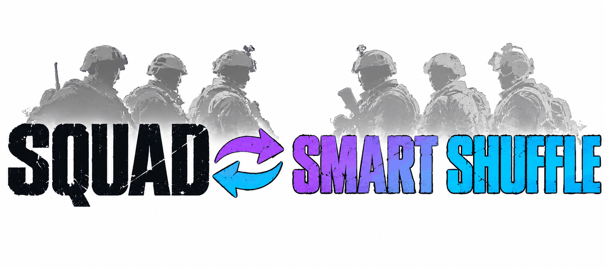

<div align="center">

<picture>
  <source media="(prefers-color-scheme: dark)" srcset="./assets/banner-dark.png">
  
</picture>

# Squad-SmartShuffle

**Mezcla inteligente de equipos para servidores de Squad. Al final de la ronda puntúa a cada jugador solo con esa partida, reparte los equipos de forma equilibrada y bloquea los cambios de equipo durante una ronda.**

[](./LICENSE)
[](https://github.com/Miabeyefendi/Squad-SmartShuffle/releases/latest)
[](#-instalación)
[](#)
[](https://github.com/Miabeyefendi)

[English](./README.md) · [Türkçe](./README_TR.md) · **Español** · [简体中文](./README_ZH.md) · [Русский](./README_RU.md)

[Instalación](#-instalación) · [Funciones](#-lo-destacado) · [Uso](#-inicio-rápido) · [Cambios](./CHANGELOG.md)

<a href="https://github.com/Miabeyefendi/Squad-SmartShuffle/releases/latest">
  
</a>
<a href="./CHANGELOG.md">
  <picture>
    <source media="(prefers-color-scheme: dark)" srcset="./assets/btn-changelog-dark.svg">
    
  </picture>
</a>

</div>

---

## ✨ Lo destacado

- **Puntúa jugadores, no equipos** - bajas, derribos, muertes, daño, reanimaciones y desplegables por minuto, suavizados para quien juega poco
- **Solo esta partida** - sin base de datos, sin historial de puntuaciones, sin Steam IDs guardados; cada ronda empieza de cero
- **Bueno en todo vence a bueno en una sola cosa** - media geométrica ponderada, así quien solo acumula bajas no supera a un jugador completo
- **Equilibrado en cada eje** - además de la fuerza total, se reparten por igual el ritmo de bajas, el daño, las muertes, las reanimaciones, la construcción y los kits (médico, tripulación de vehículo)
- **Líderes de escuadra repartidos por grupo** - los SL de vehículo, las escuadras pequeñas cerradas y las abiertas se dividen por separado
- **Los grupos de amigos siguen juntos** - el modo de bloqueo 2 mantiene cada party en un solo lado
- **Bloqueo de una ronda** - tras una mezcla, quien cambia de equipo (o se reconecta para hacerlo) vuelve a su lado hasta que acabe la ronda
- **Tres vías** - un plugin de SquadJS para servidores sin mods, una vía híbrida con un pequeño ruleset de ModLoader para el marcador completo y un Blueprint puro de ModLoader

---

## 📦 Instalación

### Requisitos

| Vía | Necesita | El servidor sigue sin mods |
|---|---|---|
| SquadJS | [SquadJS](https://github.com/Team-Silver-Sphere/SquadJS) 4.x en el servidor | Sí, los jugadores no descargan nada |
| Híbrida | SquadJS + [ModLoader](https://steamcommunity.com/sharedfiles/filedetails/?id=3516838562) + el ruleset de volcado | No, servidor con mods |
| ModLoader | ModLoader + el ruleset en Blueprint | No, servidor con mods |

### Hecho con


### Vía SquadJS

1. Descarga `smart-shuffle.js` de la [última versión de SquadJS](https://github.com/Miabeyefendi/Squad-SmartShuffle/releases/latest).
2. Cópialo en `SquadJS/squad-server/plugins/`.
3. Añade el plugin a la lista `plugins` de `config.json`:

```json
{
  "plugin": "SmartShuffle",
  "enabled": true,
  "autoShuffle": false,
  "lockMode": 2
}
```

4. Reinicia SquadJS.

<details>
<summary><b>Vía híbrida (marcador completo)</b></summary>

1. Instala la vía SquadJS de arriba y pon `"useScoreboardDump": true`.
2. En el servidor, instala [ModLoader](https://steamcommunity.com/sharedfiles/filedetails/?id=3516838562) y el [elemento SmartShuffle del Workshop](https://steamcommunity.com/sharedfiles/filedetails/?id=3835528773) (ID 3835528773).
3. Añade `/SmartShuffle/BP_SmartShuffleDump.BP_SmartShuffleDump_C` a la lista `rulesets` de `Saved/ModLoader/ModLoader.json`. El Blueprint se describe en [`src/hybrid/BP_SmartShuffleDump.md`](./src/hybrid/BP_SmartShuffleDump.md).

Si las líneas del volcado no llegan, el plugin vuelve por sí solo a los datos de SquadJS.

</details>

<details>
<summary><b>Vía ModLoader (sin SquadJS)</b></summary>

Crea `BP_SmartShuffle` en el Squad SDK siguiendo [`src/modloader/BP_SmartShuffle.md`](./src/modloader/BP_SmartShuffle.md)
y regístralo en `Saved/ModLoader/ModLoader.json`. Cada función del Blueprint tiene una equivalente probada con el
mismo nombre en `smart-shuffle.js`.

</details>

---

## 🚀 Inicio rápido

Escribe esto en el **chat de administración** del juego:

```
!smartshuffle now        mezclar una vez al final de esta ronda
!smartshuffle preview    mostrar qué haría una mezcla ahora, sin mover a nadie
!smartshuffle cancel     anular la mezcla pedida con now
!smartshuffle friends on mantener juntos a los grupos de amigos (parties) al mezclar, off los separa
!smartshuffle auto on    mezclar al final de cada ronda
!smartshuffle lock 2     bloquear tras la mezcla y mantener juntos a los grupos de amigos
!smartshuffle unlock     quitar el bloqueo durante el resto de esta ronda
!smartshuffle status     mostrar los ajustes actuales
```

Al final de la ronda el plugin mueve a los jugadores con `AdminForceTeamChange`, anuncia cuántos se movieron y
mantiene los nuevos equipos hasta que termine la siguiente ronda.

Los jugadores solo se mueven en la pantalla final, justo al terminar la ronda. Si el siguiente mapa empieza antes, la mezcla se detiene: no se mueve a nadie en una partida en curso, así que nadie pierde su escuadra, kit o vehículo por la mezcla.

---

## 🧮 Cómo funciona

1. **Recoger.** Durante la partida se cuentan, por jugador: bajas, derribos, muertes, daño, reanimaciones,
   desplegables colocados, bajas aliadas y minutos jugados. Un mapa nuevo lo borra todo.
2. **Puntuar.** Cada estadística pasa a un ritmo por minuto atraído hacia la media de la partida (30 minutos
   previos) y luego a una puntuación z comprimida entre 0 y 1, la mitad frente a todo el servidor y la mitad
   dentro del propio equipo. Cuatro categorías (KDA, Combate, Trabajo en equipo, Objetivo) se combinan con una
   media geométrica ponderada, con pesos propios para líderes de escuadra, médicos y jugadores de apoyo. Cada
   baja aliada resta un 10%.
3. **Repartir.** Primero se reparten los líderes de escuadra, grupo por grupo. El resto va al lado más débil y
   después los intercambios por parejas reducen a la vez la diferencia de fuerza total y la de cada dimensión extra.
4. **Bloquear.** El modo 1 mantiene a todos en su nuevo lado durante una ronda. El modo 2 primero lleva cada
   party a un solo lado y después lo mantiene.

En una simulación de 100 jugadores con partidas por tickets, la proporción de palizas (más de 150 tickets de
diferencia) bajó del 26% con una mezcla aleatoria al 10.4% con la fórmula de SquadJS y al 9.3% con el marcador
completo (vía híbrida).
Estas cifras son sin mantener a los amigos juntos. Con parties de hasta 4 juntas, la fórmula de SquadJS da alrededor del 11%; manteniendo todas las parties, incluidos los grupos de 9, alrededor del 13%.

---

## ⚙️ Configuración

Todas las opciones van en la entrada del plugin en el `config.json` de SquadJS.

| Clave | Por defecto | Qué hace |
|---|---|---|
| `command` | `smartshuffle` | Nombre del comando del chat de administración |
| `autoShuffle` | `false` | Mezclar al final de cada ronda |
| `lockMode` | `2` | 0 sin bloqueo, 1 bloqueo estricto, 2 bloqueo que mantiene juntas las parties |
| `keepParties` | sigue a `lockMode` | Mantener juntas las parties al mezclar, independiente del bloqueo: `true` o `false`. Si se omite, está activo con `lockMode` 2 y desactivado con 0 y 1 |
| `kitMedic` | `Medic` | Regex sobre el nombre del rol para kits de médico |
| `kitLogistics` | vacío | Regex para una clase de kit de logística, vacío significa sin usar |
| `kitCrew` | `Crewman\|Pilot` | Regex para kits de tripulación; los SL de tripulación forman su propio grupo |
| `lockedSquadMaxSize` | `3` | Una escuadra cerrada de hasta este tamaño cuenta como escuadra de amigos |
| `maxPartySize` | `4` | Modo de bloqueo 2: una party de hasta este tamaño se queda junta, una más grande se divide. 0 significa sin límite |
| `skipLayers` | `["seed", "jensen", "invasion"]` | La mezcla automática se salta una ronda cuyo nombre de layer contenga alguno de estos. `!smartshuffle now` siempre se ejecuta |
| `minPlayers` | `40` | La mezcla automática se salta una ronda con menos jugadores. `!smartshuffle now` siempre se ejecuta |
| `shuffleDelaySeconds` | `0` | Segundos de espera tras el final de la ronda antes de mover jugadores (tiempo para ver el marcador), de 0 a 25 |
| `shuffleDeadlineSeconds` | `30` | No se mueve a nadie pasados estos segundos desde el final de la ronda, y nunca después de que empiece el siguiente mapa |
| `announceMinutes` | `10` | Mientras haya una mezcla pendiente, avisar al servidor cada tantos minutos. 0 desactiva los avisos |
| `broadcastResult` | `true` | Avisar al servidor tras la mezcla de cuántos jugadores se movieron |
| `warnMovedPlayers` | `true` | Avisar a cada jugador movido con un mensaje privado de que cambió de equipo |
| `adminReport` | `true` | Enviar el resultado (movidos, no colocados, diferencia de puntuación antes y después) a los admins conectados |
| `useScoreboardDump` | `false` | Vía híbrida: leer el marcador completo del log del servidor |
| `dumpWaitSeconds` | `10` | Vía híbrida: cuánto esperar el volcado al final de la ronda |

---

## 📖 Documentación

- [**Receta Blueprint de la vía híbrida**](./src/hybrid/BP_SmartShuffleDump.md) - el ruleset de volcado y su formato de log
- [**Receta Blueprint de ModLoader**](./src/modloader/BP_SmartShuffle.md) - la versión completa dentro del juego
- [**Registro de cambios**](./CHANGELOG.md) - qué cambió en cada versión
- [**Contribuir**](./CONTRIBUTING.md) - cómo enviar un cambio
- [**Seguridad**](./SECURITY.md) - cómo informar de una vulnerabilidad en privado

Pruebas: `node --test tests/squadjs/core.test.mjs`. Comparan puntuaciones y equipos con el modelo de referencia
y ejecutan el plugin contra un servidor SquadJS simulado.

---

## 🧭 Hoja de ruta

- [ ] Ejecutar el plugin de SquadJS en un servidor real y confirmar el formato de party de `ListPlayers`
- [x] Crear y publicar en el Workshop el ruleset de volcado de la vía híbrida
- [ ] Crear el Blueprint de ModLoader

Nada de esto es una promesa. Es un proyecto personal y la lista cambia cuando
cambian mis prioridades.

---

## ❓ Preguntas frecuentes

<details>
<summary><b>¿En qué se diferencia del mezclador del juego?</b></summary>

`!randomize` mezcla al azar, así que los jugadores fuertes pueden acabar juntos. Este plugin puntúa a cada jugador
con la partida que acaba de terminar y reparte los equipos para que la fuerza total y cada tipo de aporte salgan iguales.

</details>

<details>
<summary><b>¿Guarda historial de jugadores?</b></summary>

No. Solo usa la partida que acaba de terminar y la olvida cuando carga el siguiente mapa. No escribe nada en disco.

</details>

<details>
<summary><b>¿Los jugadores tienen que descargar algo?</b></summary>

En la vía SquadJS no: el plugin corre junto al servidor y el servidor sigue sin mods. Las vías híbrida y ModLoader
necesitan ModLoader, que los jugadores descargan automáticamente al entrar, y el servidor aparece como modificado.

</details>

<details>
<summary><b>¿Pueden entrar jugadores de Epic Games?</b></summary>

En la vía SquadJS el servidor no cambia, así que quien puede entrar hoy podrá seguir haciéndolo. La versión de
Squad de Epic Games no admite mods, así que las vías híbrida y ModLoader son para jugadores de Steam.

</details>

---

## 🤝 Contribuir

Las contribuciones son bienvenidas. Lee primero [CONTRIBUTING.md](./CONTRIBUTING.md)
y [CODE_OF_CONDUCT.md](./CODE_OF_CONDUCT.md). Al contribuir aceptas licenciar tu
trabajo bajo la AGPL-3.0.

<div align="center">
<a href="https://github.com/Miabeyefendi/Squad-SmartShuffle/issues/new?template=bug_report.yml">
  <picture>
    <source media="(prefers-color-scheme: dark)" srcset="./assets/btn-report-bug-dark.svg">
    
  </picture>
</a>
<a href="https://github.com/Miabeyefendi/Squad-SmartShuffle/stargazers">
  <picture>
    <source media="(prefers-color-scheme: dark)" srcset="./assets/btn-star-dark.svg">
    
  </picture>
</a>
</div>

---

## 🙏 Créditos

- [**SquadJS**](https://github.com/Team-Silver-Sphere/SquadJS), de Team Silver Sphere - el entorno donde corre el
  plugin. Usa sus eventos de log, su RCON y `BasePlugin`, y sigue al `TeamRandomizer` estándar para mover jugadores.
- [**ModLoader**](https://steamcommunity.com/sharedfiles/filedetails/?id=3516838562), de Jhett - carga rulesets
  en capas sin mods. [SquadJSLogger](https://steamcommunity.com/sharedfiles/filedetails/?id=3586951441), del mismo
  autor, demostró que un ruleset puede escribir en el log del servidor, y la vía híbrida se apoya en eso.

---

## 🛡️ Seguridad

¿Has encontrado una vulnerabilidad? No abras una incidencia pública. Sigue el
proceso privado descrito en [SECURITY.md](./SECURITY.md).

---

## 📜 Licencia

Este proyecto está licenciado bajo la **GNU Affero General Public License v3.0
(AGPL-3.0)**, junto con los términos suplementarios del archivo
[NOTICE](./NOTICE). En resumen:

- Puedes usar, estudiar, modificar, redistribuir e incluso ganar dinero con este
  software de forma gratuita, **siempre que** mantengas el código fuente completo
  disponible bajo la AGPL-3.0, incluido cualquier uso alojado, SaaS o en red
  (AGPL Sección 13), y conserves la atribución de autoría indicada abajo.
- Para usar esta obra en un producto propietario o de código cerrado, o para
  ejecutarla como un SaaS cerrado, necesitas una **licencia comercial escrita
  aparte**, que puede incluir regalías o reparto de ingresos. Consulta
  [NOTICE](./NOTICE), Sección 8, y contacta conmigo.

### Atribución (obligatoria)

Según la Sección 7(b) de la AGPL-3.0, la siguiente atribución debe conservarse de
forma visible y sin modificar en cualquier copia, bifurcación o despliegue de
este proyecto:

> **Miabeyefendi (Mustafa Ihsan Albayrak)** - https://github.com/Miabeyefendi

### Descargo de responsabilidad

Este software se proporciona "tal cual", sin garantía de ningún tipo. Lo ejecutas
por tu cuenta y riesgo y eres la única persona responsable de tu propio uso,
incluido el cumplimiento de los términos de servicio de cualquier plataforma de
terceros con la que interactúe. Esas plataformas no están afiliadas al autor ni
lo respaldan; sus nombres y marcas pertenecen a sus respectivos propietarios. El
autor no acepta responsabilidad alguna por bloqueos de cuenta, pérdida de datos
ni ningún otro daño, en la máxima medida permitida por la ley aplicable. Los
términos completos están en los archivos [LICENSE](./LICENSE) y
[NOTICE](./NOTICE).

---

## 📬 Contacto

- GitHub: [@miabeyefendi](https://github.com/Miabeyefendi)
- Para licencias comerciales o consultas sobre reparto de ingresos, escríbeme a
  través de mi perfil de GitHub.

<div align="center">
<br/>

<br/>
<sub>Creado por <b><a href="https://github.com/Miabeyefendi">Miabeyefendi</a></b></sub>
</div>
