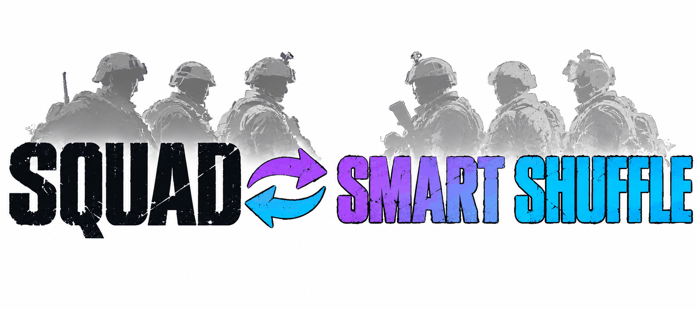
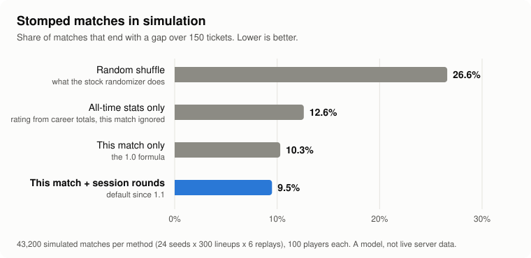

<div align="center">

<picture>
  <source media="(prefers-color-scheme: dark)" srcset="./assets/banner-dark.png">
  
</picture>

# Squad-SmartShuffle

**Умное перемешивание команд для серверов Squad. В конце раунда оценивает каждого игрока только по этому матчу, делит команды поровну и на один раунд запрещает смену команды.**

[](./LICENSE)
[](https://github.com/Miabeyefendi/Squad-SmartShuffle/releases/latest)
[](#-установка)
[](#)
[](https://github.com/Miabeyefendi)

[English](./README.md) · [Türkçe](./README_TR.md) · [Español](./README_ES.md) · [简体中文](./README_ZH.md) · **Русский**

[Установка](#-установка) · [Возможности](#-главное) · [Использование](#-быстрый-старт) · [Изменения](./CHANGELOG.md)

<a href="https://github.com/Miabeyefendi/Squad-SmartShuffle/releases/latest">
  
</a>
<a href="./CHANGELOG.md">
  <picture>
    <source media="(prefers-color-scheme: dark)" srcset="./assets/btn-changelog-dark.svg">
    
  </picture>
</a>

</div>

---

## ✨ Главное

- **Оценивает игроков, а не команды** - убийства, ранения, смерти, урон, поднятия и установленные постройки в минуту, со сглаживанием для тех, кто играл недолго
- **Только эта сессия** - этот матч и несколько последних раундов той же сессии, только в памяти; ни базы данных, ни записи на диск
- **Хороший во всём сильнее хорошего в одном** - взвешенное среднее геометрическое, поэтому фармер убийств не обгонит разностороннего игрока
- **Баланс по каждой оси** - кроме общей силы поровну делятся темп убийств, урон, смерти, поднятия, строительство и киты (медик, экипаж техники)
- **Командиры отрядов делятся по группам** - SL техники, маленькие закрытые отряды и открытые отряды делятся отдельно
- **Друзья остаются вместе** - режим блокировки 2 держит каждую party на одной стороне
- **Блокировка на один раунд** - после перемешивания сменившего команду (или перезашедшего ради этого) возвращают обратно до конца раунда
- **Три варианта** - плагин SquadJS для серверов без модов, гибрид с маленьким рулсетом ModLoader для полной таблицы счёта и чистый Blueprint для ModLoader

---

## 📦 Установка

### Требования

| Вариант | Нужно | Сервер остаётся без модов |
|---|---|---|
| SquadJS | [SquadJS](https://github.com/Team-Silver-Sphere/SquadJS) 4.x на сервере | Да, игроки ничего не скачивают |
| Гибрид | SquadJS + [ModLoader](https://steamcommunity.com/sharedfiles/filedetails/?id=3516838562) + рулсет выгрузки | Нет, сервер с модами |
| ModLoader | ModLoader + рулсет на Blueprint | Нет, сервер с модами |

### Сделано на


### Вариант SquadJS

1. Скачайте `smart-shuffle.js` из [последнего релиза SquadJS](https://github.com/Miabeyefendi/Squad-SmartShuffle/releases/latest).
2. Скопируйте его в `SquadJS/squad-server/plugins/`.
3. Добавьте плагин в список `plugins` в `config.json`:

```json
{
  "plugin": "SmartShuffle",
  "enabled": true,
  "autoShuffle": false,
  "lockMode": 2
}
```

4. Перезапустите SquadJS.

<details>
<summary><b>Гибридный вариант (полная таблица счёта)</b></summary>

1. Установите вариант SquadJS выше и задайте `"useScoreboardDump": true`.
2. Установите на сервер [ModLoader](https://steamcommunity.com/sharedfiles/filedetails/?id=3516838562) и [элемент SmartShuffle из Мастерской](https://steamcommunity.com/sharedfiles/filedetails/?id=3835528773) (ID 3835528773).
3. Добавьте `/SmartShuffle/BP_SmartShuffleDump.BP_SmartShuffleDump_C` в список `rulesets` в `Saved/ModLoader/ModLoader.json`. Сам Blueprint описан в [`src/hybrid/BP_SmartShuffleDump.md`](./src/hybrid/BP_SmartShuffleDump.md).

Если строки выгрузки не приходят, плагин сам возвращается к данным SquadJS.

</details>

<details>
<summary><b>Вариант ModLoader (без SquadJS)</b></summary>

Соберите `BP_SmartShuffle` в Squad SDK по [`src/modloader/BP_SmartShuffle.md`](./src/modloader/BP_SmartShuffle.md)
и зарегистрируйте его в `Saved/ModLoader/ModLoader.json`. У каждой функции Blueprint есть проверенный аналог с тем же
именем в `smart-shuffle.js`.

</details>

---

## 🚀 Быстрый старт

Введите в **админ-чате** игры:

```
!smartshuffle now        перемешать один раз в конце этого раунда
!smartshuffle preview    показать, что сделало бы перемешивание сейчас, никого не двигает
!smartshuffle cancel     отменить перемешивание, заказанное через now
!smartshuffle friends on держать друзей (party) вместе при перемешивании, off разделяет их
!smartshuffle history on учитывать и прошлые раунды каждого игрока в этой сессии, off берёт только этот матч
!smartshuffle mss on     подмешивать общий рейтинг из MySquadStats (нужен токен), по умолчанию выключено
!smartshuffle auto on    перемешивать в конце каждого раунда
!smartshuffle lock 2     блокировать после перемешивания и держать друзей вместе
!smartshuffle unlock     снять блокировку до конца этого раунда
!smartshuffle status     показать текущие настройки
```

В конце раунда плагин переводит игроков через `AdminForceTeamChange`, объявляет, сколько человек переведено, и держит
новые команды до конца следующего раунда.

Игроков перемещают только на финальном экране, сразу после конца раунда. Если следующая карта начнётся раньше, перемешивание остановится: в идущем матче никого не двигают, так что никто не теряет отряд, кит или технику из-за перемешивания.

---

## 📘 Пошаговое руководство

От пустого сервера до работающего перемешивания. Нужен запущенный SquadJS и права админа на сервере. Программировать не нужно.

### 1. Установка

Скачайте `smart-shuffle.js` из [последнего релиза](https://github.com/Miabeyefendi/Squad-SmartShuffle/releases/latest) и скопируйте в `SquadJS/squad-server/plugins/`.

Откройте `SquadJS/config.json`, найдите список `"plugins": [` и добавьте эту запись. Следите за запятой между записями.

```json
{
  "plugin": "SmartShuffle",
  "enabled": true,
  "autoShuffle": false
}
```

Перезапустите SquadJS. Всё, что вы не указали, остаётся по умолчанию, так что этой короткой записи достаточно.

### 2. Проверьте, что плагин загрузился

Зайдите на сервер и напишите в **админ-чат** (не в общий чат):

```
!smartshuffle status
```

Придёт личное сообщение примерно такого вида:

```
Smart Shuffle: auto off, lock on, friends on, history on, mss off, pending 0, locked now 0.
```

Нет ответа? Проверьте по порядку: файл лежит в папке `plugins`, в записи стоит `"enabled": true`, имя точно `SmartShuffle`, вы писали в админ-чат, в логе SquadJS нет ошибки при запуске.

### 3. Попробуйте, никого не перемещая

В середине матча:

```
!smartshuffle preview
```

```
Smart Shuffle preview (this match so far): 41 of 96 would move, score gap 18% -> 1%.
```

Никого не перемещают. Вы получите сводку, а в логе SquadJS будет список, кто куда ушёл бы (`Preview moves`).

### 4. Первое настоящее перемешивание

```
!smartshuffle now
```

Серверу сообщают, что команды будут сбалансированы. Когда раунд закончится, игроков перемещают на финальном экране, до загрузки следующей карты. Вам приходит отчёт:

```
Smart Shuffle report: 44 moved, 0 not placed, score gap 21% -> 1%, done in 3.2 s.
```

Передумали до конца раунда? `!smartshuffle cancel`.

### 5. Сделайте автоматическим

`!smartshuffle auto on` перемешивает в конце каждого раунда до перезапуска SquadJS. Чтобы сохранить это после перезапуска, укажите `"autoShuffle": true` в `config.json`.

### 6. Измените настройки по умолчанию

Есть два способа. Команда в чате действует сразу и до перезапуска SquadJS. Строка в `config.json` постоянна и требует перезапуска. Частые варианты:

| Я хочу | В `config.json` | В админ-чате |
|---|---|---|
| Перемешивать каждый раунд | `"autoShuffle": true` | `auto on` |
| Чистый баланс, друзей вместе не держать | `"keepParties": false` | `friends off` |
| Держать вместе группы побольше | `"maxPartySize": 6` | - |
| Без блокировки после перемешивания | `"lockMode": 0`, плюс `"keepParties": true`, чтобы друзья остались вместе | `lock off` |
| Только завершённый матч | `"historyRounds": 0` | `history off` |
| Сначала дать посмотреть таблицу | `"shuffleDelaySeconds": 15` | - |
| Без сообщений игрокам | `"announceMinutes": 0`, `"warnMovedPlayers": false`, `"broadcastResult": false` | - |
| Перемешивать и на Invasion | `"skipLayers": ["seed", "jensen"]` | - |
| Сервер поменьше | `"minPlayers": 20` | - |

Запись с несколькими изменениями выглядит так. Полный список в разделе [Настройка](#️-настройка).

```json
{
  "plugin": "SmartShuffle",
  "enabled": true,
  "autoShuffle": true,
  "maxPartySize": 3,
  "shuffleDelaySeconds": 15,
  "minPlayers": 30
}
```

### 7. По желанию: рейтинг MySquadStats

По умолчанию выключен и экспериментален: в симуляции он не улучшил баланс и пока не запускался с настоящим API. Чтобы попробовать:

1. Получите токен. MySquadStats выдаёт его каждому серверу-участнику, см. [mysquadstats.com/participate](https://mysquadstats.com/participate). Если у вас уже стоит их плагин для SquadJS, это `accessToken` в записи того плагина.
2. Добавьте эти две строки в запись SmartShuffle в `config.json`:

   ```json
   "useMySquadStats": true,
   "mySquadStatsToken": "YOUR_TOKEN"
   ```

3. Перезапустите SquadJS. `!smartshuffle status` теперь показывает `mss on`. Игроков запрашивают понемногу во время матча, так что рейтинг заполняется за первые минуты.

Держите токен в тайне: не выкладывайте свой `config.json`. `!smartshuffle mss off` выключает рейтинг без перезапуска.

---

## 🧮 Как это работает

1. **Сбор.** Во время матча для каждого игрока считаются убийства, ранения, смерти, урон, поднятия, установленные
   постройки, тимкиллы и сыгранные минуты. Новая карта начинает счёт заново; последние раунды сессии остаются в памяти для оценки.
2. **Оценка.** Каждая статистика превращается в темп в минуту, подтянутый к среднему по матчу (априорные 30 минут),
   затем в z-оценку, сжатую в диапазон 0..1: наполовину относительно всего сервера, наполовину внутри своей команды.
   Четыре категории (KDA, Бой, Командная работа, Цели) объединяются взвешенным средним геометрическим, с отдельными
   весами для командиров отрядов, медиков и игроков поддержки. Каждый тимкилл снижает оценку на 10%.
3. **Деление.** Сначала по группам делятся командиры отрядов. Остальные по очереди идут в более слабую команду, затем
   парные обмены одновременно сокращают разрыв в общей силе и в каждом дополнительном измерении.
4. **Блокировка.** Режим 1 держит всех на новой стороне один раунд. Режим 2 сначала переводит каждую party на одну
   сторону, затем держит её там.

В симуляции на 100 игроков с матчами на тикетах доля разгромов (разница больше 150 тикетов) снизилась с 26% при
случайном перемешивании до 10.4% с формулой SquadJS и до 9.3% с полной таблицей счёта (гибрид).
Эти числа получены без удержания друзей вместе. Если держать вместе party до 4 человек, формула SquadJS даёт около 11%; если держать все party, включая стаки по 9, около 13%.
Если учитывать прошлые раунды каждого игрока в сессии (по умолчанию), формула SquadJS даёт около 9.5%.

<p align="center">
  <picture>
    <source media="(prefers-color-scheme: dark)" srcset="./assets/sim-chart-dark.svg">
    
  </picture>
</p>

Четыре способа оценивать игроков, каждый проверен на 43 200 смоделированных матчах. Синяя полоса - метод, который Smart Shuffle использует по умолчанию.

---

## ⚙️ Настройка

Все параметры задаются в записи плагина в `config.json` SquadJS.

| Ключ | По умолчанию | Что делает |
|---|---|---|
| `command` | `smartshuffle` | Имя команды админ-чата |
| `autoShuffle` | `false` | Перемешивать в конце каждого раунда |
| `lockMode` | `2` | 0 без блокировки, 1 жёсткая, 2 блокировка, сохраняющая party вместе |
| `keepParties` | как в `lockMode` | Держать party вместе при перемешивании, независимо от блокировки: `true` или `false`. Если не указано, включено при `lockMode` 2 и выключено при 0 и 1 |
| `kitMedic` | `Medic` | Regex по имени роли для китов медика |
| `kitLogistics` | пусто | Regex для класса логистики, пусто значит не используется |
| `kitCrew` | `Crewman\|Pilot` | Regex для китов экипажа; SL экипажей образуют свою группу |
| `lockedSquadMaxSize` | `3` | Закрытый отряд до такого размера считается отрядом друзей |
| `maxPartySize` | `4` | Режим блокировки 2: party до этого размера остаётся вместе, большая делится. 0 означает без ограничения |
| `skipLayers` | `["seed", "jensen", "invasion"]` | Автоматическое перемешивание пропускает раунд, если название layer содержит что-то из списка. `!smartshuffle now` выполняется всегда |
| `minPlayers` | `40` | Автоматическое перемешивание пропускает раунд с меньшим числом игроков. `!smartshuffle now` выполняется всегда |
| `shuffleDelaySeconds` | `0` | Сколько секунд ждать после конца раунда перед перемещением игроков (время посмотреть таблицу), от 0 до 25 |
| `shuffleDeadlineSeconds` | `30` | Позже этого числа секунд после конца раунда никого не двигают, и никогда после старта следующей карты |
| `announceMinutes` | `10` | Пока перемешивание ожидается, сообщать серверу каждые столько минут. 0 отключает объявления |
| `broadcastResult` | `true` | Сообщать серверу после перемешивания, сколько игроков перемещено |
| `warnMovedPlayers` | `true` | Сообщать каждому перемещённому игроку в личном сообщении о смене команды |
| `adminReport` | `true` | Отправлять результат (перемещено, не размещено, разница очков до и после) админам онлайн |
| `historyRounds` | `4` | Учитывать и прошлые раунды каждого игрока в этой сессии, только в памяти: на сколько раундов назад. 0 означает только этот матч. В гибридном режиме не используется |
| `historyHours` | `6` | Раунды старше этого числа часов не учитываются |
| `useMySquadStats` | `false` | Экспериментально. Подмешивать в оценку общий рейтинг с [mysquadstats.com](https://mysquadstats.com). Нужен `mySquadStatsToken` |
| `mySquadStatsToken` | пусто | Токен доступа вашего сервера к API MySquadStats, тот же, что использует их плагин для SquadJS. Токены выдают серверам-участникам в их Discord |
| `mySquadStatsWeight` | `0.15` | Доля общего рейтинга в оценке, от 0 до 1 |
| `mySquadStatsDlc` | `vanilla` | Какую таблицу лидеров MySquadStats читать |
| `useScoreboardDump` | `false` | Гибрид: читать полную таблицу счёта из лога сервера |
| `dumpWaitSeconds` | `10` | Гибрид: сколько ждать выгрузку в конце раунда |

---

## 📖 Документация

- [**Рецепт Blueprint для гибрида**](./src/hybrid/BP_SmartShuffleDump.md) - рулсет выгрузки и формат лога
- [**Рецепт Blueprint для ModLoader**](./src/modloader/BP_SmartShuffle.md) - полная версия внутри игры
- [**Список изменений**](./CHANGELOG.md) - что изменилось в каждом релизе
- [**Участие**](./CONTRIBUTING.md) - как отправить изменение
- [**Безопасность**](./SECURITY.md) - как сообщить об уязвимости приватно

Тесты: `node --test tests/squadjs/core.test.mjs`. Они сверяют оценки и команды с эталонной моделью и запускают
плагин на имитации сервера SquadJS.

---

## 🧭 Планы

- [ ] Запустить плагин SquadJS на живом сервере и проверить формат party в `ListPlayers`
- [x] Собрать рулсет выгрузки для гибрида и опубликовать его в Мастерской
- [ ] Собрать Blueprint для ModLoader

Здесь нет обещаний. Это личный проект, и список меняется вместе с моими
приоритетами.

---

## ❓ Частые вопросы

<details>
<summary><b>Чем это отличается от встроенного перемешивания?</b></summary>

`!randomize` перемешивает случайно, и сильные игроки всё равно могут оказаться вместе. Этот плагин оценивает каждого
игрока по только что завершённому матчу и делит команды так, чтобы общая сила и каждый вид вклада были равны.

</details>

<details>
<summary><b>Хранит ли он историю игроков?</b></summary>

Нет. Он использует только что завершённый матч и по умолчанию последние 4 раунда каждого игрока в той же сессии (до 6 часов назад). Они хранятся только в памяти и исчезают при перезапуске SquadJS. На диск ничего не пишется. Поставьте `historyRounds` в 0, чтобы использовать только завершённый матч.

</details>

<details>
<summary><b>Нужно ли игрокам что-то скачивать?</b></summary>

В варианте SquadJS нет: плагин работает рядом с сервером, сервер остаётся без модов. Гибрид и ModLoader требуют ModLoader,
который игроки скачивают автоматически при входе, а сервер отображается как модифицированный.

</details>

<details>
<summary><b>Могут ли зайти игроки из Epic Games?</b></summary>

В варианте SquadJS сервер не меняется, поэтому все, кто может зайти сегодня, смогут и дальше. Версия Squad в Epic Games
не поддерживает моды, поэтому гибрид и ModLoader рассчитаны на игроков Steam.

</details>

---

## 🤝 Участие

Вклад приветствуется. Сначала прочитайте [CONTRIBUTING.md](./CONTRIBUTING.md) и
[CODE_OF_CONDUCT.md](./CODE_OF_CONDUCT.md). Внося вклад, вы соглашаетесь
лицензировать свою работу под AGPL-3.0.

<div align="center">
<a href="https://github.com/Miabeyefendi/Squad-SmartShuffle/issues/new?template=bug_report.yml">
  <picture>
    <source media="(prefers-color-scheme: dark)" srcset="./assets/btn-report-bug-dark.svg">
    
  </picture>
</a>
<a href="https://github.com/Miabeyefendi/Squad-SmartShuffle/stargazers">
  <picture>
    <source media="(prefers-color-scheme: dark)" srcset="./assets/btn-star-dark.svg">
    
  </picture>
</a>
</div>

---

## 🙏 Благодарности

- [**SquadJS**](https://github.com/Team-Silver-Sphere/SquadJS) от Team Silver Sphere - среда, в которой работает
  плагин. Он использует её события лога, RCON и `BasePlugin`, а перевод игроков повторяет стандартный `TeamRandomizer`.
- [**ModLoader**](https://steamcommunity.com/sharedfiles/filedetails/?id=3516838562) от Jhett - загружает рулсеты
  на ванильных слоях. [SquadJSLogger](https://steamcommunity.com/sharedfiles/filedetails/?id=3586951441) того же
  автора показал, что рулсет может писать в лог сервера, и на этом построен гибридный вариант.

---

## 🛡️ Безопасность

Нашли уязвимость? Не открывайте публичный issue. Следуйте приватной процедуре из
[SECURITY.md](./SECURITY.md).

---

## 📜 Лицензия

Проект распространяется под **GNU Affero General Public License v3.0
(AGPL-3.0)** вместе с дополнительными условиями из файла [NOTICE](./NOTICE).
Коротко:

- Вы можете бесплатно использовать, изучать, изменять, распространять и даже
  зарабатывать на этой работе, **при условии** что вы сохраняете полный исходный
  код доступным под AGPL-3.0, включая любое размещённое, SaaS или сетевое
  использование (AGPL, раздел 13), и сохраняете указанную ниже атрибуцию автора.
- Для использования в закрытом или проприетарном продукте, а также для запуска в
  виде закрытого SaaS требуется **отдельная письменная коммерческая лицензия**,
  которая может включать роялти или долю дохода. См. [NOTICE](./NOTICE),
  раздел 8, и свяжитесь со мной.

### Атрибуция (обязательна)

Согласно разделу 7(b) AGPL-3.0, следующая атрибуция должна сохраняться на
видном месте и без изменений в любой копии, форке или развёртывании проекта:

> **Miabeyefendi (Mustafa Ihsan Albayrak)** - https://github.com/Miabeyefendi

### Отказ от ответственности

Программа предоставляется «как есть», без каких-либо гарантий. Вы запускаете её
целиком на свой страх и риск и несёте единоличную ответственность за собственное
использование, включая соблюдение условий обслуживания любой сторонней
платформы, с которой она взаимодействует. Эти платформы не связаны с автором и
не одобряют его работу; их названия и товарные знаки принадлежат их владельцам.
Автор не несёт ответственности за блокировки аккаунтов, потерю данных и любой
другой ущерб в максимальной степени, допустимой применимым правом. Полные
условия в файлах [LICENSE](./LICENSE) и [NOTICE](./NOTICE).

---

## 📬 Контакты

- GitHub: [@miabeyefendi](https://github.com/Miabeyefendi)
- По вопросам коммерческого лицензирования или разделения дохода пишите через мой
  профиль GitHub.

<div align="center">
<br/>

<br/>
<sub>Сделано <b><a href="https://github.com/Miabeyefendi">Miabeyefendi</a></b></sub>
</div>
