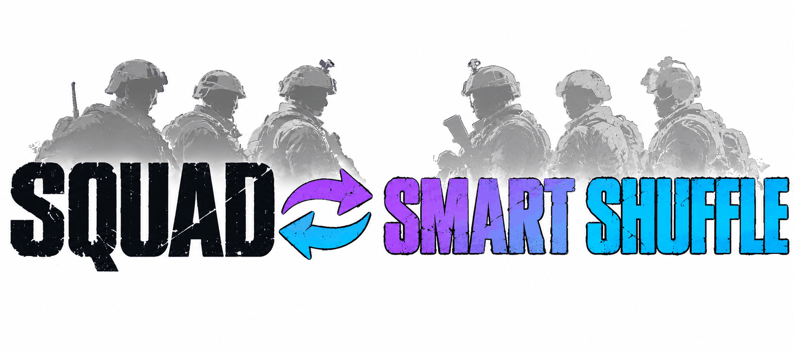

<div align="center">

<picture>
  <source media="(prefers-color-scheme: dark)" srcset="./assets/banner-dark.png">
  
</picture>

# Squad-SmartShuffle

**Squad sunucuları için akıllı takım karıştırma. Tur sonunda her oyuncuyu sadece o maçtan puanlar, takımları dengeli böler ve bir tur boyunca takım değişimini kilitler.**

[](./LICENSE)
[](https://github.com/Miabeyefendi/Squad-SmartShuffle/releases/latest)
[](#-kurulum)
[](#)
[](https://github.com/Miabeyefendi)

[English](./README.md) · **Türkçe** · [Español](./README_ES.md) · [简体中文](./README_ZH.md) · [Русский](./README_RU.md)

[Kurulum](#-kurulum) · [Özellikler](#-öne-çıkanlar) · [Kullanım](#-hızlı-başlangıç) · [Değişiklikler](./CHANGELOG.md)

<a href="https://github.com/Miabeyefendi/Squad-SmartShuffle/releases/latest">
  
</a>
<a href="./CHANGELOG.md">
  <picture>
    <source media="(prefers-color-scheme: dark)" srcset="./assets/btn-changelog-dark.svg">
    
  </picture>
</a>

</div>

---

## ✨ Öne çıkanlar

- **Takımı değil oyuncuyu puanlar** - dakika başına kill, yere indirme, ölüm, hasar, revive ve kurulan yapı; kısa oynayan için yumuşatılmış
- **Sadece bu oturum** - bu maç ve aynı oturumun son birkaç turu, yalnızca bellekte tutulur; veritabanı yok, diske hiçbir şey yazılmaz
- **Her alanda iyi olan, tek alanda iyi olanı geçer** - ağırlıklı geometrik ortalama, sadece kill kasan oyuncu çok yönlü oyuncunun önüne geçemez
- **Her eksende dengeli** - toplam gücün yanında kill hızı, hasar, ölüm, revive, inşa ve kit sayıları (medic, araç mürettebatı) da eşit bölünür
- **Squad liderleri gruplara göre bölünür** - araç SL'leri, kilitli küçük squad'lar ve açık squad'lar ayrı ayrı eşitlenir
- **Arkadaş grupları birlikte kalır** - kilit modu 2 her party'yi tek tarafta tutar
- **Bir turluk kilit** - shuffle'dan sonra takım değiştiren (ya da çıkıp girerek değiştiren) tur bitene kadar geri taşınır
- **Üç yol** - modsuz sunucu için SquadJS eklentisi, tam skorbord için küçük bir ModLoader ruleset'li karma yol ve tamamen ModLoader Blueprint'i

---

## 📦 Kurulum

### Gereksinimler

| Yol | Gerekenler | Sunucu modsuz kalır |
|---|---|---|
| SquadJS | Sunucuda [SquadJS](https://github.com/Team-Silver-Sphere/SquadJS) 4.x | Evet, oyuncular hiçbir şey indirmez |
| Karma | SquadJS + [ModLoader](https://steamcommunity.com/sharedfiles/filedetails/?id=3516838562) + döküm ruleset'i | Hayır, modlu sunucu |
| ModLoader | ModLoader + Blueprint ruleset'i | Hayır, modlu sunucu |

### Kullanılanlar


### SquadJS yolu

1. [Son SquadJS sürümünden](https://github.com/Miabeyefendi/Squad-SmartShuffle/releases/latest) `smart-shuffle.js` dosyasını indir.
2. `SquadJS/squad-server/plugins/` klasörüne kopyala.
3. Eklentiyi `config.json` içindeki `plugins` listesine ekle:

```json
{
  "plugin": "SmartShuffle",
  "enabled": true,
  "autoShuffle": false,
  "lockMode": 2
}
```

4. SquadJS'i yeniden başlat.

<details>
<summary><b>Karma yol (tam skorbord)</b></summary>

1. Yukarıdaki SquadJS yolunu kur ve `"useScoreboardDump": true` yap.
2. Sunucuya [ModLoader](https://steamcommunity.com/sharedfiles/filedetails/?id=3516838562) ve [SmartShuffle Workshop öğesini](https://steamcommunity.com/sharedfiles/filedetails/?id=3835528773) (ID 3835528773) kur.
3. `/SmartShuffle/BP_SmartShuffleDump.BP_SmartShuffleDump_C` yolunu `Saved/ModLoader/ModLoader.json` içindeki `rulesets` listesine ekle. Blueprint'in kendisi [`src/hybrid/BP_SmartShuffleDump.md`](./src/hybrid/BP_SmartShuffleDump.md) dosyasında anlatılıyor.

Döküm satırları gelmezse eklenti kendiliğinden SquadJS verisine döner.

</details>

<details>
<summary><b>ModLoader yolu (SquadJS'siz)</b></summary>

`BP_SmartShuffle`'ı Squad SDK'da [`src/modloader/BP_SmartShuffle.md`](./src/modloader/BP_SmartShuffle.md) tarifine göre kur,
sonra `Saved/ModLoader/ModLoader.json` içine kaydet. Her Blueprint fonksiyonunun `smart-shuffle.js` içinde aynı
adla test edilmiş bir karşılığı var.

</details>

---

## 🚀 Hızlı başlangıç

Oyun içi **admin sohbetine** yaz:

```
!smartshuffle now        bu turun sonunda bir kez karıştır
!smartshuffle preview    şimdi karıştırılsa ne olacağını göster, kimseyi taşımaz
!smartshuffle cancel     now ile sıraya alınan karıştırmayı iptal et
!smartshuffle friends on karıştırırken arkadaş gruplarını (party) bir arada tut, off ayırır
!smartshuffle history on her oyuncunun bu oturumdaki önceki turlarını da say, off sadece bu maçı kullanır
!smartshuffle mss on     MySquadStats'taki tüm zamanlar puanını kat (token gerekir), varsayılan kapalı
!smartshuffle auto on    her tur sonunda karıştır
!smartshuffle lock 2     shuffle sonrası kilitle, arkadaş gruplarını bir arada tut
!smartshuffle unlock     bu turun geri kalanı için kilidi kaldır
!smartshuffle status     mevcut ayarları göster
```

Tur sonunda eklenti oyuncuları `AdminForceTeamChange` ile taşır, kaç kişinin taşındığını duyurur ve yeni
takımları bir sonraki tur bitene kadar tutar.

Oyuncular yalnızca tur biter bitmez, bitiş ekranında taşınır. Sonraki harita daha önce başlarsa karıştırma durur: süren maçta kimse taşınmaz, yani kimse karıştırma yüzünden squad'ını, kitini ya da araç hakkını kaybetmez.

---

## 🧮 Nasıl çalışır

1. **Topla.** Maç boyunca oyuncu başına kill, yere indirme, ölüm, hasar, revive, kurulan yapı, teamkill ve
   oynanan dakika sayılır. Yeni harita sayımı baştan başlatır; oturumun son turları puan için bellekte tutulur.
2. **Puanla.** Her istatistik maç ortalamasına çekilmiş (30 dakikalık ön değer) dakika başına orana, sonra
   0..1 arasına sıkıştırılmış z-skora çevrilir; yarısı tüm sunucuya, yarısı oyuncunun kendi takımına göre.
   Dört kategori (KDA, Combat, Teamwork, Objective) ağırlıklı geometrik ortalamayla birleşir; squad liderleri,
   medic'ler ve destek ağırlıklı oyuncular için ayrı ağırlıklar var. Her teamkill puanı %10 düşürür.
3. **Böl.** Önce squad liderleri grup grup bölünür. Diğerleri zayıf tarafa yerleşir, sonra ikili takaslar hem
   toplam güç farkını hem de her ek boyuttaki farkı birlikte küçültür.
4. **Kilitle.** Kilit modu 1 herkesi bir tur boyunca yeni tarafında tutar. Kilit modu 2 önce her party'yi tek
   tarafa alır, sonra tutar.

Bilet tabanlı maçlarla 100 oyunculuk simülasyonda ezilen maç oranı (150 biletten fazla fark) rastgele
karıştırmada %26'dan SquadJS formülüyle %10.4'e, tam skorbordla (karma yol) %9.3'e indi.
Bu sayılar arkadaş koruması kapalıyken geçerli. 4 kişiye kadar party'ler bir arada tutulunca SquadJS formülü yaklaşık %11 veriyor; 9 kişilik gruplar dahil bütün party'ler tutulursa yaklaşık %13.
Her oyuncunun oturumdaki önceki turları da sayılınca (varsayılan) SquadJS formülü yaklaşık %9.5 veriyor.

---

## ⚙️ Yapılandırma

Bütün seçenekler SquadJS `config.json` içindeki eklenti girişine yazılır.

| Anahtar | Varsayılan | Ne yapar |
|---|---|---|
| `command` | `smartshuffle` | Admin sohbet komutunun adı |
| `autoShuffle` | `false` | Her tur sonunda karıştır |
| `lockMode` | `2` | 0 kilit yok, 1 sert kilit, 2 party'leri bir arada tutan kilit |
| `keepParties` | `lockMode`'a uyar | Karıştırırken party'leri bir arada tut, kilitten bağımsız: `true` ya da `false`. Yazılmazsa `lockMode` 2 için açık, 0 ve 1 için kapalıdır |
| `kitMedic` | `Medic` | Medic kitleri için rol adına uygulanan regex |
| `kitLogistics` | boş | Lojistik kit sınıfı için regex, boşsa kullanılmaz |
| `kitCrew` | `Crewman\|Pilot` | Araç mürettebatı kitleri için regex; mürettebat SL'leri ayrı SL grubu olur |
| `lockedSquadMaxSize` | `3` | Bu boyuta kadar kilitli squad arkadaş squad'ı sayılır |
| `maxPartySize` | `4` | Kilit modu 2: bu boyuta kadar party bir arada kalır, daha büyüğü bölünür. 0 sınır yok demek |
| `skipLayers` | `["seed", "jensen", "invasion"]` | Otomatik karıştırma, layer adı bunlardan birini içeren turu atlar. `!smartshuffle now` her zaman çalışır |
| `minPlayers` | `40` | Otomatik karıştırma, oyuncu sayısı bundan az olan turu atlar. `!smartshuffle now` her zaman çalışır |
| `shuffleDelaySeconds` | `0` | Tur bittikten sonra oyuncular taşınmadan önce beklenecek saniye (skor tablosunu okumak için), 0 ile 25 arası |
| `shuffleDeadlineSeconds` | `30` | Tur bittikten bu kadar saniye sonra kimse taşınmaz, sonraki harita başladıktan sonra da asla |
| `announceMinutes` | `10` | Karıştırma bekliyorken sunucuya bu kadar dakikada bir duyur. 0 duyuruları kapatır |
| `broadcastResult` | `true` | Karıştırmadan sonra kaç oyuncunun taşındığını sunucuya duyur |
| `warnMovedPlayers` | `true` | Taşınan her oyuncuya takımının değiştiğini özel mesajla bildir |
| `adminReport` | `true` | Sonucu (taşınan, yerleşmeyen, önceki ve sonraki puan farkı) çevrimiçi adminlere gönder |
| `historyRounds` | `4` | Her oyuncunun bu oturumdaki önceki turlarını da say, yalnızca bellekte tutulur: kaç tur geriye. 0 sadece bu maç demek. Karma yolda kullanılmaz |
| `historyHours` | `6` | Bu kadar saatten eski turlar sayılmaz |
| `useMySquadStats` | `false` | Deneysel. [mysquadstats.com](https://mysquadstats.com) üzerindeki tüm zamanlar puanını skora kat. `mySquadStatsToken` gerekir |
| `mySquadStatsToken` | boş | Sunucunun MySquadStats API erişim token'ı, onların SquadJS eklentisinin kullandığı token. Token katılımcı sunuculara Discord'larında verilir |
| `mySquadStatsWeight` | `0.15` | Tüm zamanlar puanının skordaki payı, 0 ile 1 arası |
| `mySquadStatsDlc` | `vanilla` | Hangi MySquadStats sıralaması okunacak |
| `useScoreboardDump` | `false` | Karma yol: tam skorbordu sunucu logundan oku |
| `dumpWaitSeconds` | `10` | Karma yol: tur sonunda döküm için kaç saniye beklenir |

---

## 📖 Belgeler

- [**Karma yol Blueprint tarifi**](./src/hybrid/BP_SmartShuffleDump.md) - döküm ruleset'i ve log biçimi
- [**ModLoader Blueprint tarifi**](./src/modloader/BP_SmartShuffle.md) - tamamen oyun içi sürüm
- [**Değişiklik günlüğü**](./CHANGELOG.md) - her sürümde ne değişti
- [**Katkıda bulunma**](./CONTRIBUTING.md) - değişiklik nasıl gönderilir
- [**Güvenlik**](./SECURITY.md) - zafiyet nasıl gizlice bildirilir

Testler: `node --test tests/squadjs/core.test.mjs`. Puanları ve takımları referans modelle karşılaştırır,
eklentiyi sahte bir SquadJS sunucusunda çalıştırır.

---

## 🧭 Yol haritası

- [ ] SquadJS eklentisini canlı sunucuda çalıştır, `ListPlayers` party biçimini doğrula
- [x] Karma yolun döküm ruleset'ini kur ve Workshop'ta yayınla
- [ ] ModLoader Blueprint'ini kur

Buradakilerin hiçbiri söz değildir. Bu kişisel bir proje ve liste önceliklerim
değiştikçe değişir.

---

## ❓ Sık sorulanlar

<details>
<summary><b>Oyunun kendi karıştırıcısından farkı ne?</b></summary>

`!randomize` rastgele karıştırır, güçlü oyuncular yine aynı tarafa düşebilir. Bu eklenti biten maçtan her
oyuncuyu puanlar ve takımları toplam güç ve her katkı türü eşit çıkacak şekilde böler.

</details>

<details>
<summary><b>Oyuncu geçmişi tutuyor mu?</b></summary>

Hayır. Biten maçı ve varsayılan olarak her oyuncunun aynı oturumdaki son 4 turunu (en fazla 6 saat geriye) kullanır. Bunlar yalnızca bellekte durur ve SquadJS yeniden başlayınca silinir. Diske hiçbir şey yazılmaz. Sadece biten maçı kullanmak için `historyRounds` değerini 0 yap.

</details>

<details>
<summary><b>Oyuncuların bir şey indirmesi gerekiyor mu?</b></summary>

SquadJS yolunda hayır: eklenti sunucunun yanında çalışır, sunucu modsuz kalır. Karma ve ModLoader yolları
ModLoader ister; oyuncular girerken onu otomatik indirir ve sunucu modlu olarak listelenir.

</details>

<details>
<summary><b>Epic Games oyuncuları girebilir mi?</b></summary>

SquadJS yolunda sunucu değişmez, bugün girebilen herkes yine girer. Squad'ın Epic Games sürümü mod
desteklemiyor, bu yüzden karma ve ModLoader yolları Steam oyuncuları içindir.

</details>

---

## 🤝 Katkıda bulunma

Katkılar memnuniyetle karşılanır. Önce [CONTRIBUTING.md](./CONTRIBUTING.md) ve
[CODE_OF_CONDUCT.md](./CODE_OF_CONDUCT.md) dosyalarını oku. Katkıda bulunarak
eserini AGPL-3.0 altında lisanslamayı kabul edersin.

<div align="center">
<a href="https://github.com/Miabeyefendi/Squad-SmartShuffle/issues/new?template=bug_report.yml">
  <picture>
    <source media="(prefers-color-scheme: dark)" srcset="./assets/btn-report-bug-dark.svg">
    
  </picture>
</a>
<a href="https://github.com/Miabeyefendi/Squad-SmartShuffle/stargazers">
  <picture>
    <source media="(prefers-color-scheme: dark)" srcset="./assets/btn-star-dark.svg">
    
  </picture>
</a>
</div>

---

## 🙏 Emeği geçenler

- [**SquadJS**](https://github.com/Team-Silver-Sphere/SquadJS), Team Silver Sphere - eklentinin çalıştığı
  ortam. Eklenti onun log olaylarını, RCON'unu ve `BasePlugin` sınıfını kullanır; oyuncu taşımada standart
  `TeamRandomizer`'ı izler.
- [**ModLoader**](https://steamcommunity.com/sharedfiles/filedetails/?id=3516838562), Jhett - vanilla
  layer'larda ruleset yükler. Aynı yazarın [SquadJSLogger](https://steamcommunity.com/sharedfiles/filedetails/?id=3586951441)
  modu bir ruleset'in sunucu loguna yazabildiğini gösterdi; karma yol bunun üstüne kurulu.

---

## 🛡️ Güvenlik

Bir zafiyet mi buldun? Halka açık issue açma. [SECURITY.md](./SECURITY.md)
dosyasındaki özel süreci izle.

---

## 📜 Lisans

Bu proje; [NOTICE](./NOTICE) dosyasındaki ek şartlarla birlikte **GNU Affero
General Public License v3.0 (AGPL-3.0)** altında lisanslanmıştır. Kısaca:

- Eksiksiz kaynak kodu AGPL-3.0 altında erişilebilir tuttuğun sürece
  (barındırılan, SaaS veya ağ kullanımı dahil, AGPL Bölüm 13) ve aşağıdaki yazar
  atfını koruduğun sürece bu yazılımı **ücretsiz** kullanabilir, inceleyebilir,
  değiştirebilir, dağıtabilir ve hatta para kazanabilirsin.
- Bu eseri kapalı kaynaklı veya tescilli bir üründe kullanmak ya da kapalı bir
  SaaS olarak çalıştırmak için **ayrı, yazılı bir ticari lisans** gerekir; bu
  lisans royalti veya gelir payı içerebilir. Bkz. [NOTICE](./NOTICE), Bölüm 8;
  benimle iletişime geç.

### Atıf (zorunlu)

AGPL-3.0 Bölüm 7(b) uyarınca aşağıdaki atıf; bu projenin her kopyasında,
fork'unda veya dağıtımında görünür ve değiştirilmeden korunmalıdır:

> **Miabeyefendi (Mustafa İhsan Albayrak)** - https://github.com/Miabeyefendi

### Sorumluluk reddi

Bu yazılım, hiçbir garanti olmaksızın "olduğu gibi" sunulur. Tamamen kendi
riskinle çalıştırırsın ve kendi kullanımından, etkileştiği herhangi bir üçüncü
taraf platformun kullanım koşullarına uymak dahil, yalnızca sen sorumlusun. Bu
platformlar yazarla bağlı veya yazar tarafından onaylanmış değildir; adları ve
ticari markaları ilgili sahiplerine aittir. Yazar; hesap yasakları, veri kaybı
veya başka herhangi bir zarardan, uygulanabilir yasanın izin verdiği azami ölçüde
sorumlu değildir. Tam şartlar [LICENSE](./LICENSE) ve [NOTICE](./NOTICE)
dosyalarındadır.

---

## 📬 İletişim

- GitHub: [@miabeyefendi](https://github.com/Miabeyefendi)
- Ticari lisanslama veya gelir paylaşımı için GitHub profilim üzerinden bana
  ulaş.

<div align="center">
<br/>

<br/>
<sub><b><a href="https://github.com/Miabeyefendi">Miabeyefendi</a></b> tarafından yapıldı</sub>
</div>
