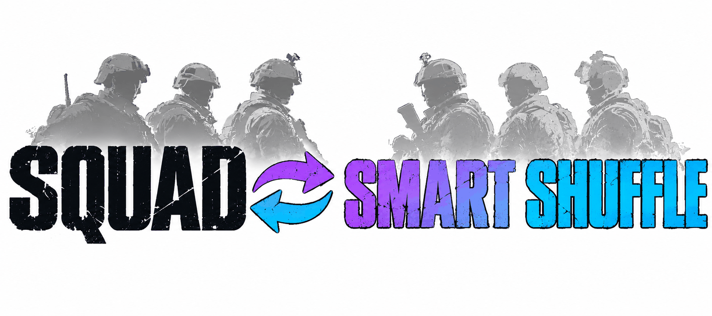
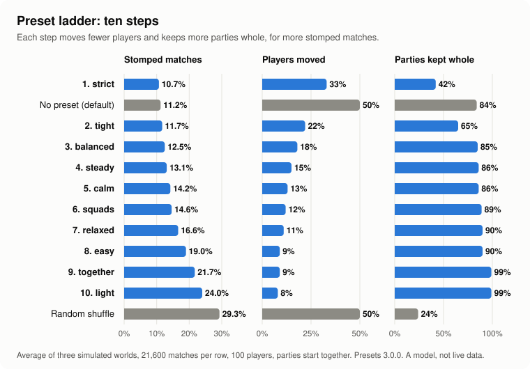
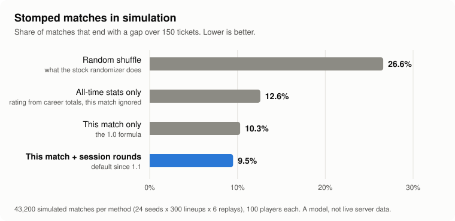

<div align="center">

<picture>
  <source media="(prefers-color-scheme: dark)" srcset="./assets/banner-dark.png">
  
</picture>

# Squad-SmartShuffle

**Squad sunucuları için akıllı takım karıştırma. Tur sonunda her oyuncuyu sadece o maçtan puanlar, takımları dengeli böler ve bir tur boyunca takım değişimini kilitler.**

[](./LICENSE)
[](https://github.com/Miabeyefendi/Squad-SmartShuffle/releases/latest)
[](#-kurulum)
[](#)
[](https://github.com/Miabeyefendi)

[English](./README.md) · **Türkçe** · [Español](./README_ES.md) · [简体中文](./README_ZH.md) · [Русский](./README_RU.md)

[Kurulum](#-kurulum) · [Özellikler](#-öne-çıkanlar) · [Kullanım](#-hızlı-başlangıç) · [Değişiklikler](./CHANGELOG.md)

<a href="https://github.com/Miabeyefendi/Squad-SmartShuffle/releases/latest">
  
</a>
<a href="./CHANGELOG.md">
  <picture>
    <source media="(prefers-color-scheme: dark)" srcset="./assets/btn-changelog-dark.svg">
    
  </picture>
</a>

</div>

---

## ✨ Öne çıkanlar

- **Takımı değil oyuncuyu puanlar** - dakika başına kill, yere indirme, ölüm, hasar, revive ve kurulan yapı; kısa oynayan için yumuşatılmış
- **Sadece bu oturum** - bu maç ve aynı oturumun son birkaç turu, yalnızca bellekte tutulur; veritabanı yok, diske hiçbir şey yazılmaz
- **Her alanda iyi olan, tek alanda iyi olanı geçer** - ağırlıklı geometrik ortalama, sadece kill kasan oyuncu çok yönlü oyuncunun önüne geçemez
- **Her eksende dengeli** - toplam gücün yanında kill hızı, hasar, ölüm, revive, inşa ve kit sayıları (medic, araç mürettebatı) da eşit bölünür
- **Squad liderleri gruplara göre bölünür** - araç SL'leri, kilitli küçük squad'lar ve açık squad'lar ayrı ayrı eşitlenir
- **Arkadaş grupları birlikte kalır** - kilit modu 2 her party'yi tek tarafta tutar
- **Bir turluk kilit** - shuffle'dan sonra takım değiştiren (ya da çıkıp girerek değiştiren) tur bitene kadar geri taşınır
- **Üç yol** - modsuz sunucu için SquadJS eklentisi, tam skorbord için küçük bir ModLoader ruleset'li karma yol ve tamamen ModLoader Blueprint'i

---

## 📦 Kurulum

### Gereksinimler

| Yol | Gerekenler | Sunucu modsuz kalır |
|---|---|---|
| SquadJS | Sunucuda [SquadJS](https://github.com/Team-Silver-Sphere/SquadJS) 4.x | Evet, oyuncular hiçbir şey indirmez |
| Karma | SquadJS + [ModLoader](https://steamcommunity.com/sharedfiles/filedetails/?id=3516838562) + döküm ruleset'i | Hayır, modlu sunucu |
| ModLoader | ModLoader + Blueprint ruleset'i | Hayır, modlu sunucu |

### Kullanılanlar


### SquadJS yolu

1. [Son SquadJS sürümünden](https://github.com/Miabeyefendi/Squad-SmartShuffle/releases/latest) `smart-shuffle.js` dosyasını indir.
2. `SquadJS/squad-server/plugins/` klasörüne kopyala.
3. Eklentiyi `config.json` içindeki `plugins` listesine ekle:

```json
{
  "plugin": "SmartShuffle",
  "enabled": true,
  "autoShuffle": false,
  "lockMode": 2
}
```

4. SquadJS'i yeniden başlat.

### 🎛️ Hazır presetler

**[Smart Shuffle](https://github.com/Miabeyefendi/Squad-SmartShuffle/releases/latest)** sürümü bütün presetleri içerir. `<Ad>.zip` sadece SquadJS ister; `Modloader-<Ad>.zip` aynı presetin hibrit yoldaki hali (SquadJS + ModLoader + SmartShuffle Workshop öğesi, tam skor tablosu). Her zip'te `smart-shuffle.js` (SquadJS 1.4.0) ve kilit, parti, geçmiş ve az taşıma ayarlarıyla eksiksiz bir `config.json` girdisi var. [`All-presets.zip`](https://github.com/Miabeyefendi/Squad-SmartShuffle/releases/latest/download/All-presets.zip) hepsini birden içerir.

On basamak bir merdiven oluşturur: 1. basamak en dengeli takımları verir; her sonraki basamak daha az oyuncu taşır ve daha çok arkadaş grubunu bütün tutar, karşılığında ezilen maç artar.

| Basamak | Sürüm dosyası | Ezilen maç | Taşınan oyuncu | Bütün kalan parti | En uygun |
|:---:|---|:---:|:---:|:---:|---|
| **1** | [`Strict.zip`](https://github.com/Miabeyefendi/Squad-SmartShuffle/releases/latest/download/Strict.zip) · [`Modloader-Strict.zip`](https://github.com/Miabeyefendi/Squad-SmartShuffle/releases/latest/download/Modloader-Strict.zip) | **10.7%** | **33%** | **42%** | en dengeli takımlar, ikililer kalır |
| | [`Default.zip`](https://github.com/Miabeyefendi/Squad-SmartShuffle/releases/latest/download/Default.zip) · [`Modloader-Default.zip`](https://github.com/Miabeyefendi/Squad-SmartShuffle/releases/latest/download/Modloader-Default.zip) *(eklentinin kendi ayarları)* | 11.2% | 50% | 84% | |
| **2** | [`Tight.zip`](https://github.com/Miabeyefendi/Squad-SmartShuffle/releases/latest/download/Tight.zip) · [`Modloader-Tight.zip`](https://github.com/Miabeyefendi/Squad-SmartShuffle/releases/latest/download/Modloader-Tight.zip) | **11.7%** | **22%** | **65%** | dengeli takımlar, üçlüler kalır |
| **3** | [`Balanced.zip`](https://github.com/Miabeyefendi/Squad-SmartShuffle/releases/latest/download/Balanced.zip) · [`Modloader-Balanced.zip`](https://github.com/Miabeyefendi/Squad-SmartShuffle/releases/latest/download/Modloader-Balanced.zip) | **12.5%** | **18%** | **85%** | çoğu sunucu |
| **4** | [`Steady.zip`](https://github.com/Miabeyefendi/Squad-SmartShuffle/releases/latest/download/Steady.zip) · [`Modloader-Steady.zip`](https://github.com/Miabeyefendi/Squad-SmartShuffle/releases/latest/download/Modloader-Steady.zip) | **13.1%** | **15%** | **86%** | çoğu sunucu, daha az taşıma |
| **5** | [`Calm.zip`](https://github.com/Miabeyefendi/Squad-SmartShuffle/releases/latest/download/Calm.zip) · [`Modloader-Calm.zip`](https://github.com/Miabeyefendi/Squad-SmartShuffle/releases/latest/download/Modloader-Calm.zip) | **14.2%** | **13%** | **86%** | taşınmaktan hoşlanmayan oyuncular |
| **6** | [`Squads.zip`](https://github.com/Miabeyefendi/Squad-SmartShuffle/releases/latest/download/Squads.zip) · [`Modloader-Squads.zip`](https://github.com/Miabeyefendi/Squad-SmartShuffle/releases/latest/download/Modloader-Squads.zip) | **14.6%** | **12%** | **89%** | 6 kişiye kadar arkadaş squad'ları |
| **7** | [`Relaxed.zip`](https://github.com/Miabeyefendi/Squad-SmartShuffle/releases/latest/download/Relaxed.zip) · [`Modloader-Relaxed.zip`](https://github.com/Miabeyefendi/Squad-SmartShuffle/releases/latest/download/Modloader-Relaxed.zip) | **16.6%** | **11%** | **90%** | sıkı denge yerine az taşıma |
| **8** | [`Easy.zip`](https://github.com/Miabeyefendi/Squad-SmartShuffle/releases/latest/download/Easy.zip) · [`Modloader-Easy.zip`](https://github.com/Miabeyefendi/Squad-SmartShuffle/releases/latest/download/Modloader-Easy.zip) | **19.0%** | **9%** | **90%** | sadece belirgin dengesizlikler |
| **9** | [`Together.zip`](https://github.com/Miabeyefendi/Squad-SmartShuffle/releases/latest/download/Together.zip) · [`Modloader-Together.zip`](https://github.com/Miabeyefendi/Squad-SmartShuffle/releases/latest/download/Modloader-Together.zip) | **21.7%** | **9%** | **99%** | klanlar ve büyük gruplar |
| **10** | [`Light.zip`](https://github.com/Miabeyefendi/Squad-SmartShuffle/releases/latest/download/Light.zip) · [`Modloader-Light.zip`](https://github.com/Miabeyefendi/Squad-SmartShuffle/releases/latest/download/Modloader-Light.zip) | **24.0%** | **8%** | **99%** | en küçük karıştırma |
| | *rastgele karıştırma (eklenti yok)* | 29.3% | 50% | 24% | |

Ezilen maç: bilet farkı 150'yi geçen maçların oranı, üç simüle dünyanın ortalaması. Taşınan oyuncu: karıştırmada takım değiştiren oyuncuların oranı. Ayrıntılar [Nasıl çalışır](#-nasıl-çalışır) bölümünde.

<p align="center">
  <picture>
    <source media="(prefers-color-scheme: dark)" srcset="./assets/ladder-chart-dark.svg">
    
  </picture>
</p>

**Basamaktan basamağa ne değişiyor.** Onu da `lockMode` 2, `keepParties` true, `historyRounds` 8 ve `historyHours` 12 kullanır; sadece şu iki ayar değişir:

| Basamak | Preset | `maxPartySize` | `fewerMoves` |
|:---:|---|:---:|:---:|
| 1 | `Strict` | 2 | 0.1 |
| 2 | `Tight` | 3 | 0.3 |
| 3 | `Balanced` | 4 | 0.3 |
| 4 | `Steady` | 4 | 0.6 |
| 5 | `Calm` | 4 | 1 |
| 6 | `Squads` | 6 | 1 |
| 7 | `Relaxed` | 6 | 2 |
| 8 | `Easy` | 6 | 4 |
| 9 | `Together` | sınırsız | 2 |
| 10 | `Light` | sınırsız | 4 |

Modloader presetleri de simüle edildi: yukarıdaki vanilla değerlerinin yaklaşık yarım puan yakınında kalıyorlar, çünkü hibrit yol tam skor tablosundan puanlıyor ama oturum geçmişini saymıyor. ModLoader sunucu adımları kendi README'lerinde.

<details>
<summary><b>Karma yol (tam skorbord)</b></summary>

1. Yukarıdaki SquadJS yolunu kur ve `"useScoreboardDump": true` yap.
2. Sunucuya [ModLoader](https://steamcommunity.com/sharedfiles/filedetails/?id=3516838562) ve [SmartShuffle Workshop öğesini](https://steamcommunity.com/sharedfiles/filedetails/?id=3835528773) (ID 3835528773) kur.
3. `Saved/ModLoader/ModLoader.json` içinde (sürüm 2) `rulesets` altına `"/SmartShuffle/BP_SmartShuffleDump.BP_SmartShuffleDump_C": true` satırını ekle. Eski liste biçimi otomatik dönüştürülür. Yükleme 2026-11-22'de yerel bir Windows dedicated sunucuda denendi: ModLoader `BP_SmartShuffleDump` dosyasını ruleset olarak ekliyor. Blueprint'in kendisi [`src/hybrid/BP_SmartShuffleDump.md`](./src/hybrid/BP_SmartShuffleDump.md) dosyasında anlatılıyor.

Döküm satırları gelmezse eklenti kendiliğinden SquadJS verisine döner.

</details>

<details>
<summary><b>ModLoader yolu (SquadJS'siz)</b></summary>

`BP_SmartShuffle`'ı Squad SDK'da [`src/modloader/BP_SmartShuffle.md`](./src/modloader/BP_SmartShuffle.md) tarifine göre kur,
sonra `Saved/ModLoader/ModLoader.json` içine kaydet. Her Blueprint fonksiyonunun `smart-shuffle.js` içinde aynı
adla test edilmiş bir karşılığı var.

</details>

---

## 🚀 Hızlı başlangıç

Oyun içi **admin sohbetine** yaz:

```
!smartshuffle now        bu turun sonunda bir kez karıştır
!smartshuffle preview    şimdi karıştırılsa ne olacağını göster, kimseyi taşımaz
!smartshuffle cancel     now ile sıraya alınan karıştırmayı iptal et
!smartshuffle friends on karıştırırken arkadaş gruplarını (party) bir arada tut, off ayırır
!smartshuffle history on her oyuncunun bu oturumdaki önceki turlarını da say, off sadece bu maçı kullanır
!smartshuffle mss on     MySquadStats'taki tüm zamanlar puanını kat (token gerekir), varsayılan kapalı
!smartshuffle auto on    her tur sonunda karıştır
!smartshuffle lock 2     shuffle sonrası kilitle, arkadaş gruplarını bir arada tut
!smartshuffle unlock     bu turun geri kalanı için kilidi kaldır
!smartshuffle status     mevcut ayarları göster
```

Tur sonunda eklenti oyuncuları `AdminForceTeamChange` ile taşır, kaç kişinin taşındığını duyurur ve yeni
takımları bir sonraki tur bitene kadar tutar.

Oyuncular yalnızca tur biter bitmez, bitiş ekranında taşınır. Sonraki harita daha önce başlarsa karıştırma durur: süren maçta kimse taşınmaz, yani kimse karıştırma yüzünden squad'ını, kitini ya da araç hakkını kaybetmez.

---

## 📘 Adım adım rehber

Boş sunucudan çalışan karıştırmaya. Çalışan bir SquadJS ve sunucuda admin yetkisi yeterli. Kod bilmek gerekmez.

### 1. Kur

`smart-shuffle.js` dosyasını [son sürümden](https://github.com/Miabeyefendi/Squad-SmartShuffle/releases/latest) indir ve `SquadJS/squad-server/plugins/` klasörüne kopyala.

`SquadJS/config.json` dosyasını aç, `"plugins": [` listesini bul ve şu girdiyi ekle. Girdiler arasındaki virgüle dikkat et.

```json
{
  "plugin": "SmartShuffle",
  "enabled": true,
  "autoShuffle": false
}
```

SquadJS'i yeniden başlat. Yazmadığın her ayar varsayılanında kalır, bu kısa girdi yeterli.

### 2. Yüklendiğini kontrol et

Sunucuya gir ve **admin sohbetine** (genel sohbete değil) şunu yaz:

```
!smartshuffle status
```

Şuna benzer bir özel mesaj gelir:

```
Smart Shuffle: auto off, lock on, friends on, history on, mss off, pending 0, locked now 0.
```

Cevap yok mu? Sırayla bak: dosya `plugins` klasöründe mi, girdide `"enabled": true` var mı, ad tam olarak `SmartShuffle` mı, admin sohbetine mi yazdın, SquadJS log'unda açılışta hata var mı.

### 3. Kimseyi taşımadan dene

Maçın ortasında:

```
!smartshuffle preview
```

```
Smart Shuffle preview (this match so far): 41 of 96 would move, score gap 18% -> 1%.
```

Kimse taşınmaz. Bir özet gelir, kimin nereye gideceği SquadJS log'una yazılır (`Preview moves`).

### 4. İlk gerçek karıştırmayı çalıştır

```
!smartshuffle now
```

Sunucuya takımların dengeleneceği duyurulur. Tur bitince oyuncular bitiş ekranında, sonraki harita yüklenmeden taşınır. Sana bir rapor gelir:

```
Smart Shuffle report: 44 moved, 0 not placed, score gap 21% -> 1%, done in 3.2 s.
```

Tur bitmeden vazgeçtin mi? `!smartshuffle cancel`.

### 5. Otomatiğe al

`!smartshuffle auto on`, SquadJS yeniden başlayana kadar her tur sonunda karıştırır. Yeniden başlatmadan sonra da kalsın istersen `config.json` içine `"autoShuffle": true` yaz.

### 6. Varsayılanları değiştir

İki yol var. Sohbet komutu hemen çalışır ve SquadJS yeniden başlayana kadar geçerlidir. `config.json` satırı kalıcıdır ve yeniden başlatma ister. Sık yapılan seçimler:

| İstediğim | `config.json` içinde | Admin sohbetinde |
|---|---|---|
| Her tur karıştırma | `"autoShuffle": true` | `auto on` |
| Saf denge, arkadaşlar bir arada tutulmasın | `"keepParties": false` | `friends off` |
| Daha büyük arkadaş grupları bir arada kalsın | `"maxPartySize": 6` | - |
| Karıştırmadan sonra kilit olmasın | `"lockMode": 0`, arkadaşlar yine tutulsun dersen `"keepParties": true` | `lock off` |
| Sadece biten maç sayılsın | `"historyRounds": 0` | `history off` |
| Önce skor tablosu okunsun | `"shuffleDelaySeconds": 15` | - |
| Oyunculara mesaj gitmesin | `"announceMinutes": 0`, `"warnMovedPlayers": false`, `"broadcastResult": false` | - |
| Invasion'da da karıştır | `"skipLayers": ["seed", "jensen"]` | - |
| Daha küçük sunucu | `"minPlayers": 20` | - |

Birkaç değişiklik içeren bir girdi şöyle görünür. Tam liste [Yapılandırma](#️-yapılandırma) bölümünde.

```json
{
  "plugin": "SmartShuffle",
  "enabled": true,
  "autoShuffle": true,
  "maxPartySize": 3,
  "shuffleDelaySeconds": 15,
  "minPlayers": 30
}
```

### 7. İsteğe bağlı: MySquadStats puanı

Varsayılan olarak kapalı ve deneysel: simülasyonda dengeyi iyileştirmedi ve henüz gerçek API'ye karşı çalıştırılmadı. Denemek için:

1. Token al. MySquadStats her katılımcı sunucuya bir token verir, bkz. [mysquadstats.com/participate](https://mysquadstats.com/participate). Onların SquadJS eklentisini zaten kullanıyorsan, o eklentinin girdisindeki `accessToken` değeridir.
2. `config.json` içindeki SmartShuffle girdisine şu iki satırı ekle:

   ```json
   "useMySquadStats": true,
   "mySquadStatsToken": "YOUR_TOKEN"
   ```

3. SquadJS'i yeniden başlat. `!smartshuffle status` artık `mss on` gösterir. Oyuncular maç sırasında azar azar sorgulanır, puan ilk dakikalarda dolar.

Token'ı gizli tut: `config.json` dosyanı herkese açık yerde paylaşma. `!smartshuffle mss off`, yeniden başlatmadan puanı kapatır.

---

## 🧮 Nasıl çalışır

1. **Topla.** Maç boyunca oyuncu başına kill, yere indirme, ölüm, hasar, revive, kurulan yapı, teamkill ve
   oynanan dakika sayılır. Yeni harita sayımı baştan başlatır; oturumun son turları puan için bellekte tutulur.
2. **Puanla.** Her istatistik maç ortalamasına çekilmiş (30 dakikalık ön değer) dakika başına orana, sonra
   0..1 arasına sıkıştırılmış z-skora çevrilir; yarısı tüm sunucuya, yarısı oyuncunun kendi takımına göre.
   Dört kategori (KDA, Combat, Teamwork, Objective) ağırlıklı geometrik ortalamayla birleşir; squad liderleri,
   medic'ler ve destek ağırlıklı oyuncular için ayrı ağırlıklar var. Her teamkill puanı %10 düşürür.
3. **Böl.** Önce squad liderleri grup grup bölünür. Diğerleri zayıf tarafa yerleşir, sonra ikili takaslar hem
   toplam güç farkını hem de her ek boyuttaki farkı birlikte küçültür.
4. **Kilitle.** Kilit modu 1 herkesi bir tur boyunca yeni tarafında tutar. Kilit modu 2 önce her party'yi tek
   tarafa alır, sonra tutar.

Bilet tabanlı maçlarla 100 oyunculuk simülasyonda ezilen maç oranı (150 biletten fazla fark) rastgele
karıştırmada %26'dan SquadJS formülüyle %10.4'e, tam skorbordla (karma yol) %9.3'e indi.
Bu sayılar arkadaş koruması kapalıyken geçerli. 4 kişiye kadar party'ler bir arada tutulunca SquadJS formülü yaklaşık %11 veriyor; 9 kişilik gruplar dahil bütün party'ler tutulursa yaklaşık %13.
Her oyuncunun oturumdaki önceki turları da sayılınca (varsayılan) SquadJS formülü yaklaşık %9.5 veriyor.

<p align="center">
  <picture>
    <source media="(prefers-color-scheme: dark)" srcset="./assets/sim-chart-dark.svg">
    
  </picture>
</p>

Oyuncuları puanlamanın dört yolu, her biri 43.200 simüle maçta denendi. Mavi çubuk, Smart Shuffle'ın varsayılan olarak kullandığı yöntem.


### Preset simülasyonu

Her basamak üç simüle dünyada, her birinde 7.200 maç (basamak başına 21.600) oynatıldı: 100 oyuncu, maç başına 2 ila 4 kişilik 6 ila 10 küçük parti ve 6 ila 9 kişilik 1 ya da 2 büyük grup, Squad'daki gibi aynı takımda başlayan partiler, önceki turların bilet modeli ve her turda oyuncuların %20'sinin yeni olduğu oturum geçmişi. Bilet farkı 150'yi geçen maç ezilmiş sayılır.

- **ana:** bu akşamın formu değişiyor (%15) ve parti üyeleri birlikte daha iyi oynuyor (parti sinerjisi %15)
- **sinerjisiz:** partiler birlikte daha güçlü değil
- **dalgalı:** bu akşamın formu iki kat değişiyor (%30)

| Basamak | Preset | ana | sinerjisiz | dalgalı |
|:---:|---|:---:|:---:|:---:|
| 1 | `Strict` | 10.0% | 10.2% | 11.9% |
|  | *preset yok (eklenti varsayılanı)* | 10.5% | 11.0% | 12.2% |
| 2 | `Tight` | 10.8% | 11.1% | 13.2% |
| 3 | `Balanced` | 11.8% | 11.7% | 13.9% |
| 4 | `Steady` | 12.2% | 12.3% | 14.8% |
| 5 | `Calm` | 13.4% | 12.9% | 16.2% |
| 6 | `Squads` | 13.7% | 13.4% | 16.6% |
| 7 | `Relaxed` | 15.7% | 15.1% | 19.0% |
| 8 | `Easy` | 18.2% | 17.2% | 21.7% |
| 9 | `Together` | 21.1% | 17.9% | 26.2% |
| 10 | `Light` | 23.2% | 20.3% | 28.6% |
|  | *rastgele karıştırma (eklenti yok)* | 28.0% | 27.7% | 32.1% |

Sonuçlar:

- On basamak %10,7'den %24,0 ezilen maça yayılıyor; taşınan oyuncu %33'ten %8'e iniyor, bütün kalan parti %42'den %99'a çıkıyor. Her sütun tek yönde ilerliyor.
- Eklentinin görebildiği veriyle alt sınır yaklaşık %10. Her oyuncunun gerçek gücünü bilen bir bölme %5,5 ila 6'ya iniyor, ama sadece maç istatistiklerini gören her yöntem %9,5 ila 10,5'te kaldı: daha uzun ya da daha ağır oturum geçmişi, önceki akşamların geçmişi, hibrit yolun tam skor tablosu (oturum geçmişiyle ve geçmişsiz), dakika başı oranları doğrudan dengelemek, önceki turların takım sonuçlarından Elo benzeri bir puan ve farklı yumuşatma, takım payı ve lambda ayarları denendi. Aradaki fark oyuncuyu istatistiğinden puanlamanın sınırı; bu veriyle %7 ila 8 ulaşılamıyor.
- Az taşıma için partilerin yerinde kalması gerekiyor: `fewerMoves` açıkken tutulan her parti şu an oynadığı tarafta kalır.
- Büyük gruplar dengeden en çok götürüyor: 9. ve 10. basamak her partiyi tuttuğu için dalgalı dünyada en hızlı yükselenler bunlar.

Bunlar model sonuçları, canlı veri değil.

---

## ⚙️ Yapılandırma

Bütün seçenekler SquadJS `config.json` içindeki eklenti girişine yazılır.

Her aç/kapa ayarı `true`/`false` ya da `"on"`/`"off"` alır. Her sayı ayarı bir sayı ya da `"off"` alır; `0` o özelliği her zaman kapatır (`1` açık, daha büyük değerler ek basamaklar).

| Anahtar | Varsayılan | Ne yapar |
|---|---|---|
| `command` | `smartshuffle` | Admin sohbet komutunun adı |
| `autoShuffle` | `false` | Her tur sonunda karıştır |
| `lockMode` | `2` | 0 kilit yok, 1 sert kilit, 2 party'leri bir arada tutan kilit |
| `keepParties` | `lockMode`'a uyar | Karıştırırken party'leri bir arada tut, kilitten bağımsız: `true` ya da `false`. Yazılmazsa `lockMode` 2 için açık, 0 ve 1 için kapalıdır |
| `kitMedic` | `Medic` | Medic kitleri için rol adına uygulanan regex |
| `kitLogistics` | boş | Lojistik kit sınıfı için regex, boşsa kullanılmaz |
| `kitCrew` | `Crewman\|Pilot` | Araç mürettebatı kitleri için regex; mürettebat SL'leri ayrı SL grubu olur |
| `lockedSquadMaxSize` | `3` | Bu boyuta kadar kilitli squad arkadaş squad'ı sayılır |
| `maxPartySize` | `4` | Kilit modu 2: bu boyuta kadar party bir arada kalır, daha büyüğü bölünür. 0 sınır yok demek |
| `skipLayers` | `["seed", "jensen", "invasion"]` | Otomatik karıştırma, layer adı bunlardan birini içeren turu atlar. `!smartshuffle now` her zaman çalışır |
| `minPlayers` | `40` | Otomatik karıştırma, oyuncu sayısı bundan az olan turu atlar. `!smartshuffle now` her zaman çalışır |
| `fewerMoves` | `0` | Daha az oyuncu taşı. 0 kapalı. 0'dan büyükse daha çok oyuncu mevcut takımında kalır, denge farkı en fazla bu oran kadar büyüyebilir. `0.1` taşınan oyuncuyu yaklaşık üçte bir azaltır (simülasyonda %50'den %33'e), ezilen maç oranı aynı kalır. En fazla `10`; büyük değerler daha da az oyuncu taşır (`4`: yaklaşık onda bir), karşılığında ezilen maç artar. Açıkken tutulan partiler şu an oynadıkları tarafta kalır |
| `lockCheckSeconds` | `5` | Takımlar kilitliyken oyuncu listesini bu sıklıkla (saniye) oku; değişim yaklaşık 30 sn yerine birkaç saniyede geri alınır. `0` = sadece SquadJS'in kendi güncellemesi |
| `announceLockStart` | `on` | Kilitli turun başında sunucuya takım değişiminin kilitli olduğunu söyle |
| `announceLockEnd` | `off` | Tur sonunda kilit kalkınca sunucuya söyle |
| `reportSkips` | `on` | Otomatik karıştırma atlanınca çevrimiçi adminlere nedenini söyle |
| `switchTokens` | `off` | Değişim tokenı: kilitli turda oyuncu geri taşınmak yerine token harcayarak takım değiştirebilir. Tokenlar `tokenFile` içinde saklanır |
| `tokenStart` | `2` | Her oyuncunun sahip olduğu ve zamanla geri aldığı token sayısı |
| `tokenMax` | `5` | Bir oyuncunun tutabileceği en çok token. `0` = sınırsız |
| `tokenRefillHours` | `24` | Harcanan token bu kadar saat sonra geri gelir, `tokenStart`'a kadar. `0` = hiç |
| `tokenSeedMinutes` | `[15, 60, 180]` | Bir günde her biri kalıcı token kazandıran seed dakikaları: 15 dk'da +1, 1 saatte +2, 3 saatte +3. `[]` = seed tokenı yok |
| `tokenSeedPlayers` | `50` | Bu sayıdan az oyuncuyken ya da adında seed geçen katmanda sunucu seed sayılır. `0` = sadece seed katmanları |
| `tokenDecayDays` | `21` | Bu kadar gün gelmeyen oyuncu her dönemde kazandığı bir tokenı kaybeder, `tokenStart`'ın altına inmez. `0` = hiç |
| `tokenMessages` | `on` | Tokenlarla ilgili özel mesajlar: kullanıldı, kaldı, kazanıldı, süresi doldu |
| `tokenCommand` | `tokens` | Her oyuncunun tokenlarını görmek için yazabileceği sohbet komutu (`!tokens`). `"off"` = komut yok |
| `tokenFile` | `smart-shuffle-tokens.json` | Tokenların saklandığı dosya, SquadJS klasörüne göre |
| `shuffleDelaySeconds` | `0` | Tur bittikten sonra oyuncular taşınmadan önce beklenecek saniye (skor tablosunu okumak için), 0 ile 25 arası |
| `shuffleDeadlineSeconds` | `30` | Tur bittikten bu kadar saniye sonra kimse taşınmaz, sonraki harita başladıktan sonra da asla |
| `announceMinutes` | `10` | Karıştırma bekliyorken sunucuya bu kadar dakikada bir duyur. 0 duyuruları kapatır |
| `broadcastResult` | `true` | Karıştırmadan sonra kaç oyuncunun taşındığını sunucuya duyur |
| `warnMovedPlayers` | `true` | Taşınan her oyuncuya takımının değiştiğini özel mesajla bildir |
| `adminReport` | `true` | Sonucu (taşınan, yerleşmeyen, önceki ve sonraki puan farkı) çevrimiçi adminlere gönder |
| `historyRounds` | `4` | Her oyuncunun bu oturumdaki önceki turlarını da say, yalnızca bellekte tutulur: kaç tur geriye. 0 sadece bu maç demek. Karma yolda kullanılmaz |
| `historyHours` | `6` | Bu kadar saatten eski turlar sayılmaz |
| `useMySquadStats` | `false` | Deneysel. [mysquadstats.com](https://mysquadstats.com) üzerindeki tüm zamanlar puanını skora kat. `mySquadStatsToken` gerekir |
| `mySquadStatsToken` | boş | Sunucunun MySquadStats API erişim token'ı, onların SquadJS eklentisinin kullandığı token. Token katılımcı sunuculara Discord'larında verilir |
| `mySquadStatsWeight` | `0.15` | Tüm zamanlar puanının skordaki payı, 0 ile 1 arası |
| `mySquadStatsDlc` | `vanilla` | Hangi MySquadStats sıralaması okunacak |
| `useScoreboardDump` | `false` | Karma yol: tam skorbordu sunucu logundan oku |
| `dumpWaitSeconds` | `10` | Karma yol: tur sonunda döküm için kaç saniye beklenir |

---

## 📖 Belgeler

- [**Karma yol Blueprint tarifi**](./src/hybrid/BP_SmartShuffleDump.md) - döküm ruleset'i ve log biçimi
- [**ModLoader Blueprint tarifi**](./src/modloader/BP_SmartShuffle.md) - tamamen oyun içi sürüm
- [**Değişiklik günlüğü**](./CHANGELOG.md) - her sürümde ne değişti
- [**Katkıda bulunma**](./CONTRIBUTING.md) - değişiklik nasıl gönderilir
- [**Güvenlik**](./SECURITY.md) - zafiyet nasıl gizlice bildirilir

Testler: `node --test tests/squadjs/core.test.mjs`. Puanları ve takımları referans modelle karşılaştırır,
eklentiyi sahte bir SquadJS sunucusunda çalıştırır.

---

## 🧭 Yol haritası

- [ ] SquadJS eklentisini canlı sunucuda çalıştır, `ListPlayers` party biçimini doğrula
- [x] Karma yolun döküm ruleset'ini kur ve Workshop'ta yayınla
- [ ] ModLoader Blueprint'ini kur

Buradakilerin hiçbiri söz değildir. Bu kişisel bir proje ve liste önceliklerim
değiştikçe değişir.

---

## ❓ Sık sorulanlar

<details>
<summary><b>Oyunun kendi karıştırıcısından farkı ne?</b></summary>

`!randomize` rastgele karıştırır, güçlü oyuncular yine aynı tarafa düşebilir. Bu eklenti biten maçtan her
oyuncuyu puanlar ve takımları toplam güç ve her katkı türü eşit çıkacak şekilde böler.

</details>

<details>
<summary><b>Oyuncu geçmişi tutuyor mu?</b></summary>

Hayır. Biten maçı ve varsayılan olarak her oyuncunun aynı oturumdaki son 4 turunu (en fazla 6 saat geriye) kullanır. Bunlar yalnızca bellekte durur ve SquadJS yeniden başlayınca silinir. Diske hiçbir şey yazılmaz. Sadece biten maçı kullanmak için `historyRounds` değerini 0 yap.

</details>

<details>
<summary><b>Oyuncuların bir şey indirmesi gerekiyor mu?</b></summary>

SquadJS yolunda hayır: eklenti sunucunun yanında çalışır, sunucu modsuz kalır. Karma ve ModLoader yolları
ModLoader ister; oyuncular girerken onu otomatik indirir ve sunucu modlu olarak listelenir.

</details>

<details>
<summary><b>Epic Games oyuncuları girebilir mi?</b></summary>

SquadJS yolunda sunucu değişmez, bugün girebilen herkes yine girer. Squad'ın Epic Games sürümü mod
desteklemiyor, bu yüzden karma ve ModLoader yolları Steam oyuncuları içindir.

</details>

---

## 🤝 Katkıda bulunma

Katkılar memnuniyetle karşılanır. Önce [CONTRIBUTING.md](./CONTRIBUTING.md) ve
[CODE_OF_CONDUCT.md](./CODE_OF_CONDUCT.md) dosyalarını oku. Katkıda bulunarak
eserini AGPL-3.0 altında lisanslamayı kabul edersin.

<div align="center">
<a href="https://github.com/Miabeyefendi/Squad-SmartShuffle/issues/new?template=bug_report.yml">
  <picture>
    <source media="(prefers-color-scheme: dark)" srcset="./assets/btn-report-bug-dark.svg">
    
  </picture>
</a>
<a href="https://github.com/Miabeyefendi/Squad-SmartShuffle/stargazers">
  <picture>
    <source media="(prefers-color-scheme: dark)" srcset="./assets/btn-star-dark.svg">
    
  </picture>
</a>
</div>

---

## 🙏 Emeği geçenler

- [**SquadJS**](https://github.com/Team-Silver-Sphere/SquadJS), Team Silver Sphere - eklentinin çalıştığı
  ortam. Eklenti onun log olaylarını, RCON'unu ve `BasePlugin` sınıfını kullanır; oyuncu taşımada standart
  `TeamRandomizer`'ı izler.
- [**ModLoader**](https://steamcommunity.com/sharedfiles/filedetails/?id=3516838562), Jhett - vanilla
  layer'larda ruleset yükler. Aynı yazarın [SquadJSLogger](https://steamcommunity.com/sharedfiles/filedetails/?id=3586951441)
  modu bir ruleset'in sunucu loguna yazabildiğini gösterdi; karma yol bunun üstüne kurulu.

---

## 🛡️ Güvenlik

Bir zafiyet mi buldun? Halka açık issue açma. [SECURITY.md](./SECURITY.md)
dosyasındaki özel süreci izle.

---

## 📜 Lisans

Bu proje; [NOTICE](./NOTICE) dosyasındaki ek şartlarla birlikte **GNU Affero
General Public License v3.0 (AGPL-3.0)** altında lisanslanmıştır. Kısaca:

- Eksiksiz kaynak kodu AGPL-3.0 altında erişilebilir tuttuğun sürece
  (barındırılan, SaaS veya ağ kullanımı dahil, AGPL Bölüm 13) ve aşağıdaki yazar
  atfını koruduğun sürece bu yazılımı **ücretsiz** kullanabilir, inceleyebilir,
  değiştirebilir, dağıtabilir ve hatta para kazanabilirsin.
- Bu eseri kapalı kaynaklı veya tescilli bir üründe kullanmak ya da kapalı bir
  SaaS olarak çalıştırmak için **ayrı, yazılı bir ticari lisans** gerekir; bu
  lisans royalti veya gelir payı içerebilir. Bkz. [NOTICE](./NOTICE), Bölüm 8;
  benimle iletişime geç.

### Atıf (zorunlu)

AGPL-3.0 Bölüm 7(b) uyarınca aşağıdaki atıf; bu projenin her kopyasında,
fork'unda veya dağıtımında görünür ve değiştirilmeden korunmalıdır:

> **Miabeyefendi (Mustafa İhsan Albayrak)** - https://github.com/Miabeyefendi

### Sorumluluk reddi

Bu yazılım, hiçbir garanti olmaksızın "olduğu gibi" sunulur. Tamamen kendi
riskinle çalıştırırsın ve kendi kullanımından, etkileştiği herhangi bir üçüncü
taraf platformun kullanım koşullarına uymak dahil, yalnızca sen sorumlusun. Bu
platformlar yazarla bağlı veya yazar tarafından onaylanmış değildir; adları ve
ticari markaları ilgili sahiplerine aittir. Yazar; hesap yasakları, veri kaybı
veya başka herhangi bir zarardan, uygulanabilir yasanın izin verdiği azami ölçüde
sorumlu değildir. Tam şartlar [LICENSE](./LICENSE) ve [NOTICE](./NOTICE)
dosyalarındadır.

---

## 📬 İletişim

- GitHub: [@miabeyefendi](https://github.com/Miabeyefendi)
- Ticari lisanslama veya gelir paylaşımı için GitHub profilim üzerinden bana
  ulaş.

<div align="center">
<br/>

<br/>
<sub><b><a href="https://github.com/Miabeyefendi">Miabeyefendi</a></b> tarafından yapıldı</sub>
</div>
