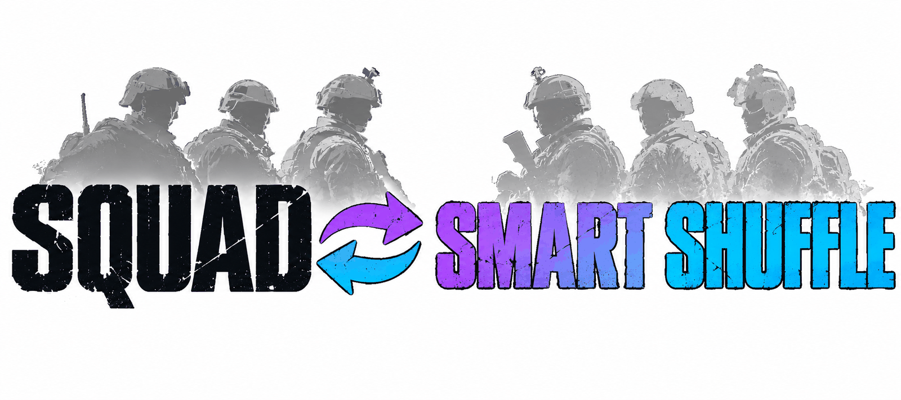
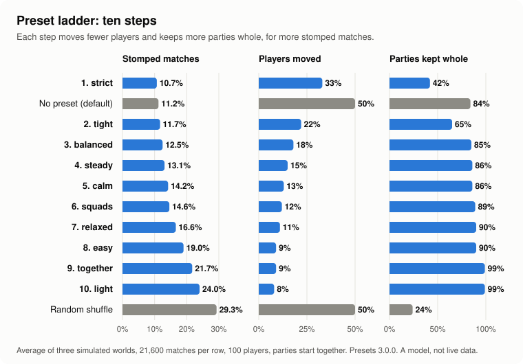
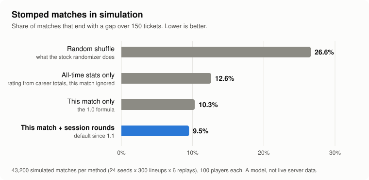

<div align="center">

<picture>
  <source media="(prefers-color-scheme: dark)" srcset="./assets/banner-dark.png">
  
</picture>

# Squad-SmartShuffle

**Squad 服务器的智能分队。每局结束时只根据这一局给每位玩家评分，把两队分得均衡，并在接下来一局锁定换队。**

[](./LICENSE)
[](https://github.com/Miabeyefendi/Squad-SmartShuffle/releases/latest)
[](#-安装)
[](#)
[](https://github.com/Miabeyefendi)

[English](./README.md) · [Türkçe](./README_TR.md) · [Español](./README_ES.md) · **简体中文** · [Русский](./README_RU.md)

[安装](#-安装) · [功能](#-亮点) · [用法](#-快速开始) · [更新日志](./CHANGELOG.md)

<a href="https://github.com/Miabeyefendi/Squad-SmartShuffle/releases/latest">
  
</a>
<a href="./CHANGELOG.md">
  <picture>
    <source media="(prefers-color-scheme: dark)" srcset="./assets/btn-changelog-dark.svg">
    
  </picture>
</a>

</div>

---

## ✨ 亮点

- **给玩家评分，而不是给队伍评分** - 每分钟击杀、击倒、死亡、伤害、救起和部署物数量，游戏时间短的玩家会被平滑处理
- **只看本次会话** - 这一局加上同一会话最近的几局，只保存在内存中；没有数据库，不向磁盘写入任何内容
- **全面的玩家胜过偏科的玩家** - 使用加权几何平均，只刷击杀的玩家排不到全面玩家前面
- **每个维度都均衡** - 除了总实力，击杀速度、伤害、死亡、救起、建造和兵种数量（医疗兵、载具乘员）也平均分配
- **小队长按组分配** - 载具小队长、上锁的小型小队和开放小队分别平均分配
- **好友组留在一起** - 锁定模式 2 让每个 party 留在同一边
- **锁定一局** - 分队后换队（或重连换队）的玩家会被移回，直到这一局结束
- **三种方式** - 适用于无模组服务器的 SquadJS 插件、带小型 ModLoader 规则集以获取完整记分板的混合方式，以及纯 ModLoader 蓝图

---

## 📦 安装

### 需求

| 方式 | 需要 | 服务器保持无模组 |
|---|---|---|
| SquadJS | 服务器上的 [SquadJS](https://github.com/Team-Silver-Sphere/SquadJS) 4.x | 是，玩家无需下载任何东西 |
| 混合 | SquadJS + [ModLoader](https://steamcommunity.com/sharedfiles/filedetails/?id=3516838562) + 导出规则集 | 否，模组服务器 |
| ModLoader | ModLoader + 蓝图规则集 | 否，模组服务器 |

### 技术栈


### SquadJS 方式

1. 从[最新的 SquadJS 版本](https://github.com/Miabeyefendi/Squad-SmartShuffle/releases/latest)下载 `smart-shuffle.js`。
2. 复制到 `SquadJS/squad-server/plugins/`。
3. 在 `config.json` 的 `plugins` 列表中加入插件：

```json
{
  "plugin": "SmartShuffle",
  "enabled": true,
  "autoShuffle": false,
  "lockMode": 2
}
```

4. 重启 SquadJS。

### 🎛️ 现成预设

**[Smart Shuffle](https://github.com/Miabeyefendi/Squad-SmartShuffle/releases/latest)** 版本包含所有预设。`<名称>.zip` 只需要 SquadJS；`Modloader-<名称>.zip` 是同一预设的混合方式（SquadJS + ModLoader + SmartShuffle 创意工坊物品，完整计分板）。每个 zip 都包含 `smart-shuffle.js`（SquadJS 1.4.0）和一个完整的 `config.json` 条目（锁定、组队、历史和少移动设置）。[`All-presets.zip`](https://github.com/Miabeyefendi/Squad-SmartShuffle/releases/latest/download/All-presets.zip) 包含全部预设。

十个级别构成一个阶梯：第 1 级队伍最平衡；之后每一级移动的玩家更少，保持完整的朋友组更多，代价是碾压局更多。

| 级别 | 版本文件 | 碾压局 | 被移动的玩家 | 保持完整的组队 | 最适合 |
|:---:|---|:---:|:---:|:---:|---|
| **1** | [`Strict.zip`](https://github.com/Miabeyefendi/Squad-SmartShuffle/releases/latest/download/Strict.zip) · [`Modloader-Strict.zip`](https://github.com/Miabeyefendi/Squad-SmartShuffle/releases/latest/download/Modloader-Strict.zip) | **10.7%** | **33%** | **42%** | 最平衡的队伍，两人组保留 |
| | [`Default.zip`](https://github.com/Miabeyefendi/Squad-SmartShuffle/releases/latest/download/Default.zip) · [`Modloader-Default.zip`](https://github.com/Miabeyefendi/Squad-SmartShuffle/releases/latest/download/Modloader-Default.zip) *(插件自带设置)* | 11.2% | 50% | 84% | |
| **2** | [`Tight.zip`](https://github.com/Miabeyefendi/Squad-SmartShuffle/releases/latest/download/Tight.zip) · [`Modloader-Tight.zip`](https://github.com/Miabeyefendi/Squad-SmartShuffle/releases/latest/download/Modloader-Tight.zip) | **11.7%** | **22%** | **65%** | 平衡的队伍，三人组保留 |
| **3** | [`Balanced.zip`](https://github.com/Miabeyefendi/Squad-SmartShuffle/releases/latest/download/Balanced.zip) · [`Modloader-Balanced.zip`](https://github.com/Miabeyefendi/Squad-SmartShuffle/releases/latest/download/Modloader-Balanced.zip) | **12.5%** | **18%** | **85%** | 大多数服务器 |
| **4** | [`Steady.zip`](https://github.com/Miabeyefendi/Squad-SmartShuffle/releases/latest/download/Steady.zip) · [`Modloader-Steady.zip`](https://github.com/Miabeyefendi/Squad-SmartShuffle/releases/latest/download/Modloader-Steady.zip) | **13.1%** | **15%** | **86%** | 大多数服务器，移动更少 |
| **5** | [`Calm.zip`](https://github.com/Miabeyefendi/Squad-SmartShuffle/releases/latest/download/Calm.zip) · [`Modloader-Calm.zip`](https://github.com/Miabeyefendi/Squad-SmartShuffle/releases/latest/download/Modloader-Calm.zip) | **14.2%** | **13%** | **86%** | 不喜欢被移动的玩家 |
| **6** | [`Squads.zip`](https://github.com/Miabeyefendi/Squad-SmartShuffle/releases/latest/download/Squads.zip) · [`Modloader-Squads.zip`](https://github.com/Miabeyefendi/Squad-SmartShuffle/releases/latest/download/Modloader-Squads.zip) | **14.6%** | **12%** | **89%** | 最多 6 人的朋友小队 |
| **7** | [`Relaxed.zip`](https://github.com/Miabeyefendi/Squad-SmartShuffle/releases/latest/download/Relaxed.zip) · [`Modloader-Relaxed.zip`](https://github.com/Miabeyefendi/Squad-SmartShuffle/releases/latest/download/Modloader-Relaxed.zip) | **16.6%** | **11%** | **90%** | 宁可少移动也不要严格平衡 |
| **8** | [`Easy.zip`](https://github.com/Miabeyefendi/Squad-SmartShuffle/releases/latest/download/Easy.zip) · [`Modloader-Easy.zip`](https://github.com/Miabeyefendi/Squad-SmartShuffle/releases/latest/download/Modloader-Easy.zip) | **19.0%** | **9%** | **90%** | 只修正明显的失衡 |
| **9** | [`Together.zip`](https://github.com/Miabeyefendi/Squad-SmartShuffle/releases/latest/download/Together.zip) · [`Modloader-Together.zip`](https://github.com/Miabeyefendi/Squad-SmartShuffle/releases/latest/download/Modloader-Together.zip) | **21.7%** | **9%** | **99%** | 战队和大组队 |
| **10** | [`Light.zip`](https://github.com/Miabeyefendi/Squad-SmartShuffle/releases/latest/download/Light.zip) · [`Modloader-Light.zip`](https://github.com/Miabeyefendi/Squad-SmartShuffle/releases/latest/download/Modloader-Light.zip) | **24.0%** | **8%** | **99%** | 最小的打乱 |
| | *随机打乱（不用插件）* | 29.3% | 50% | 24% | |

碾压局：票数差超过 150 的对局比例，三个模拟世界的平均值。被移动的玩家：一次打乱中换队的玩家比例。详见[工作原理](#-工作原理)。

<p align="center">
  <picture>
    <source media="(prefers-color-scheme: dark)" srcset="./assets/ladder-chart-dark.svg">
    
  </picture>
</p>

**每一级改动了什么。** 十个预设都使用 `lockMode` 2、`keepParties` true、`historyRounds` 8 和 `historyHours` 12；只有这两项设置变化：

| 级别 | 预设 | `maxPartySize` | `fewerMoves` |
|:---:|---|:---:|:---:|
| 1 | `Strict` | 2 | 0.1 |
| 2 | `Tight` | 3 | 0.3 |
| 3 | `Balanced` | 4 | 0.3 |
| 4 | `Steady` | 4 | 0.6 |
| 5 | `Calm` | 4 | 1 |
| 6 | `Squads` | 6 | 1 |
| 7 | `Relaxed` | 6 | 2 |
| 8 | `Easy` | 6 | 4 |
| 9 | `Together` | 不限 | 2 |
| 10 | `Light` | 不限 | 4 |

Modloader 预设也做了模拟：结果与上面的 vanilla 数值相差约半个百分点以内，因为混合方式用完整计分板评分，但不计入会话历史。ModLoader 服务器步骤写在各自的 README 中。

<details>
<summary><b>混合方式（完整记分板）</b></summary>

1. 先按上面安装 SquadJS 方式，并设置 `"useScoreboardDump": true`。
2. 在服务器上安装 [ModLoader](https://steamcommunity.com/sharedfiles/filedetails/?id=3516838562) 和 [SmartShuffle 创意工坊物品](https://steamcommunity.com/sharedfiles/filedetails/?id=3835528773)（ID 3835528773）。
3. 在 `Saved/ModLoader/ModLoader.json`（版本 2）的 `rulesets` 下加入 `"/SmartShuffle/BP_SmartShuffleDump.BP_SmartShuffleDump_C": true`。旧的列表写法会被自动转换。加载已于 2026-11-22 在本地 Windows 专用服务器上验证：ModLoader 会把 `BP_SmartShuffleDump` 作为 ruleset 加入。蓝图本身的说明见 [`src/hybrid/BP_SmartShuffleDump.md`](./src/hybrid/BP_SmartShuffleDump.md)。

如果导出行没有出现，插件会自动退回使用 SquadJS 数据。

</details>

<details>
<summary><b>ModLoader 方式（无需 SquadJS）</b></summary>

按照 [`src/modloader/BP_SmartShuffle.md`](./src/modloader/BP_SmartShuffle.md) 在 Squad SDK 中制作 `BP_SmartShuffle`，
然后在 `Saved/ModLoader/ModLoader.json` 中注册。每个蓝图函数在 `smart-shuffle.js` 中都有同名且经过测试的对应实现。

</details>

---

## 🚀 快速开始

在游戏内的**管理员聊天**中输入：

```
!smartshuffle now        本局结束时分队一次
!smartshuffle preview    显示现在分队会怎样，不会移动任何人
!smartshuffle cancel     取消用 now 预定的分队
!smartshuffle friends on 分队时让好友组（party）留在一起，off 则拆开
!smartshuffle history on 同时计入每个玩家在本次会话中之前的对局，off 则只用这一局
!smartshuffle mss on     混入 MySquadStats 的历史评分（需要 token），默认关闭
!smartshuffle auto on    每局结束时分队
!smartshuffle lock 2     分队后锁定，并让好友组留在一起
!smartshuffle unlock     解除本局剩余时间的锁定
!smartshuffle status     显示当前设置
```

每局结束时，插件用 `AdminForceTeamChange` 移动玩家，广播移动了多少人，并保持新队伍直到下一局结束。

只会在对局刚结束的结算界面移动玩家。如果下一张地图先开始，分队会停止：进行中的对局不会移动任何人，所以没有人会因为分队而失去小队、兵种或载具。

---

## 📘 分步指南

从空服务器到能用的分队。你需要一个正在运行的 SquadJS 和服务器管理员权限。不需要会写代码。

### 1. 安装

从[最新版本](https://github.com/Miabeyefendi/Squad-SmartShuffle/releases/latest)下载 `smart-shuffle.js`，复制到 `SquadJS/squad-server/plugins/`。

打开 `SquadJS/config.json`，找到 `"plugins": [` 列表并加入下面这一项。注意各项之间的逗号。

```json
{
  "plugin": "SmartShuffle",
  "enabled": true,
  "autoShuffle": false
}
```

重启 SquadJS。没写的设置都保持默认值，所以这段简短的配置就够了。

### 2. 确认已加载

进入服务器，在**管理员聊天**（不是全体聊天）里输入：

```
!smartshuffle status
```

你会收到一条类似这样的私信：

```
Smart Shuffle: auto off, lock on, friends on, history on, mss off, pending 0, locked now 0.
```

没有回应？按顺序检查：文件在 `plugins` 文件夹里，配置项写了 `"enabled": true`，名称正好是 `SmartShuffle`，你是在管理员聊天里输入的，SquadJS 启动日志里没有报错。

### 3. 先试一下，不移动任何人

对局进行中：

```
!smartshuffle preview
```

```
Smart Shuffle preview (this match so far): 41 of 96 would move, score gap 18% -> 1%.
```

不会移动任何人。你会收到一条摘要，SquadJS 日志里会列出谁会去哪边（`Preview moves`）。

### 4. 执行第一次真正的分队

```
!smartshuffle now
```

全服会收到将要平衡队伍的公告。对局结束时，玩家在结算界面、下一张地图加载之前被移动。你会收到一份报告：

```
Smart Shuffle report: 44 moved, 0 not placed, score gap 21% -> 1%, done in 3.2 s.
```

对局结束前改主意了？`!smartshuffle cancel`。

### 5. 设为自动

`!smartshuffle auto on` 会在每局结束时分队，直到 SquadJS 重启。想在重启后仍然生效，在 `config.json` 里写 `"autoShuffle": true`。

### 6. 修改默认设置

有两种方式。聊天命令立即生效，持续到 SquadJS 重启。`config.json` 里的一行是永久的，需要重启。常见选择：

| 我想要 | 在 `config.json` 里 | 在管理员聊天里 |
|---|---|---|
| 每局都分队 | `"autoShuffle": true` | `auto on` |
| 纯粹的平衡，不保留好友组 | `"keepParties": false` | `friends off` |
| 保留更大的好友组 | `"maxPartySize": 6` | - |
| 分队后不锁定 | `"lockMode": 0`，想继续保留好友再加 `"keepParties": true` | `lock off` |
| 只用刚结束的对局 | `"historyRounds": 0` | `history off` |
| 先留时间看计分板 | `"shuffleDelaySeconds": 15` | - |
| 不给玩家发消息 | `"announceMinutes": 0`、`"warnMovedPlayers": false`、`"broadcastResult": false` | - |
| Invasion 也分队 | `"skipLayers": ["seed", "jensen"]` | - |
| 人数较少的服务器 | `"minPlayers": 20` | - |

包含多项修改的配置如下。完整列表见[配置](#️-配置)。

```json
{
  "plugin": "SmartShuffle",
  "enabled": true,
  "autoShuffle": true,
  "maxPartySize": 3,
  "shuffleDelaySeconds": 15,
  "minPlayers": 30
}
```

### 7. 可选：MySquadStats 评分

默认关闭，属于实验功能：在模拟中它没有改善平衡，而且尚未对真实 API 运行过。想试用的话：

1. 获取 token。MySquadStats 会给每个参与的服务器发一个，见 [mysquadstats.com/participate](https://mysquadstats.com/participate)。如果你已经在用他们的 SquadJS 插件，就是那个插件配置里的 `accessToken`。
2. 在 `config.json` 的 SmartShuffle 配置项里加上这两行：

   ```json
   "useMySquadStats": true,
   "mySquadStatsToken": "YOUR_TOKEN"
   ```

3. 重启 SquadJS。`!smartshuffle status` 现在会显示 `mss on`。玩家会在对局中分批查询，评分在最初几分钟内补齐。

请保管好 token：不要公开发布你的 `config.json`。`!smartshuffle mss off` 可以不重启就关闭评分。

---

## 🧮 工作原理

1. **收集。** 对局中按玩家统计：击杀、击倒、死亡、伤害、救起、放置的部署物、误杀队友和游戏分钟数。换新地图时重新计数；本次会话最近的几局保留在内存中用于评分。
2. **评分。** 每项数据先转换为每分钟比率，并向本局平均值收缩（30 分钟先验），再转换为压缩到 0..1 的 z 分数；
   一半相对于整个服务器，一半相对于玩家自己的队伍。四个类别（KDA、战斗、团队、目标）用加权几何平均合并，
   小队长、医疗兵和偏支援的玩家有各自的权重。每次误杀队友扣 10%。
3. **分配。** 先按组分配小队长。其他玩家依次进入较弱的一方，然后通过成对交换同时缩小总实力差距和每个额外维度的差距。
4. **锁定。** 锁定模式 1 让每个人在新的一边保持一局。锁定模式 2 先把每个 party 移到同一边，再保持住。

在以票数决胜的 100 人模拟中，碾压局（票数差超过 150）的比例从随机分队的 26% 降到 SquadJS 公式的 10.4%，
使用完整记分板（混合方式）时为 9.3%。
以上数字未开启好友保留。保留不超过 4 人的 party 时，SquadJS 公式约为 11%；保留所有 party（包括 9 人车队）时约为 13%。
计入每个玩家在本次会话中之前的对局时（默认），SquadJS 公式约为 9.5%。

<p align="center">
  <picture>
    <source media="(prefers-color-scheme: dark)" srcset="./assets/sim-chart-dark.svg">
    
  </picture>
</p>

四种给玩家评分的方式，每种都在 43,200 场模拟对局中测试。蓝色条是 Smart Shuffle 默认使用的方法。


### 预设模拟

每一级都在三个模拟世界中各打了 7,200 局（每级共 21,600 局）：100 名玩家，每局 6 到 10 个 2 到 4 人的小组队和 1 到 2 个 6 到 9 人的大组队，组队像在 Squad 中一样从同一队伍开始，使用前几轮的票数模型，以及每轮 20% 新玩家的会话历史。票数差超过 150 的对局算作碾压局。

- **主要：** 今晚的状态会变化（15%），组队成员一起时表现更好（组队协同 15%）
- **无协同：** 组队在一起时并不更强
- **波动：** 今晚的状态变化翻倍（30%）

| 级别 | 预设 | 主要 | 无协同 | 波动 |
|:---:|---|:---:|:---:|:---:|
| 1 | `Strict` | 10.0% | 10.2% | 11.9% |
|  | *不用预设（插件默认）* | 10.5% | 11.0% | 12.2% |
| 2 | `Tight` | 10.8% | 11.1% | 13.2% |
| 3 | `Balanced` | 11.8% | 11.7% | 13.9% |
| 4 | `Steady` | 12.2% | 12.3% | 14.8% |
| 5 | `Calm` | 13.4% | 12.9% | 16.2% |
| 6 | `Squads` | 13.7% | 13.4% | 16.6% |
| 7 | `Relaxed` | 15.7% | 15.1% | 19.0% |
| 8 | `Easy` | 18.2% | 17.2% | 21.7% |
| 9 | `Together` | 21.1% | 17.9% | 26.2% |
| 10 | `Light` | 23.2% | 20.3% | 28.6% |
|  | *随机打乱（不用插件）* | 28.0% | 27.7% | 32.1% |

结果：

- 十个级别的碾压局从 10.7% 扩展到 24.0%，被移动的玩家从 33% 降到 8%，保持完整的组队从 42% 升到 99%。每一列都只朝一个方向变化。
- 对插件能看到的数据来说，约 10% 是下限。知道每名玩家真实能力的分配能达到 5.5% 到 6%，但所有只看比赛统计的方法都停在 9.5% 到 10.5%：更长或权重更大的会话历史、其他晚上的历史、混合方式的完整计分板（含与不含会话历史）、直接平衡每分钟比率、根据之前回合队伍结果的类 Elo 评分，以及其他先验、队内比例和 lambda 设置都测试过。差距来自根据统计数据评估玩家的极限，所以用这些数据达不到 7% 到 8%。
- 少移动需要组队留在原地：开启 `fewerMoves` 时，每个保持的组队都留在其当前所在的一边。
- 大组队对平衡的代价最大：第 9 和第 10 级保留所有组队，因此在波动世界中上升最快。

这些是模型结果，不是实际数据。

---

## ⚙️ 配置

所有选项都写在 SquadJS `config.json` 的插件条目中。

每个开关都接受 `true`/`false` 或 `"on"`/`"off"`。每个数值都接受数字或 `"off"`，`0` 总是关闭该功能（`1` 为开启，更大的值是额外级别）。

| 键 | 默认值 | 作用 |
|---|---|---|
| `command` | `smartshuffle` | 管理员聊天命令名 |
| `autoShuffle` | `false` | 每局结束时分队 |
| `lockMode` | `2` | 0 不锁定，1 严格锁定，2 保持 party 在一起的锁定 |
| `keepParties` | 跟随 `lockMode` | 分队时让 party 留在一起，与锁定无关：`true` 或 `false`。不填时，`lockMode` 为 2 时开启，为 0 和 1 时关闭 |
| `kitMedic` | `Medic` | 用于识别医疗兵兵种的角色名正则 |
| `kitLogistics` | 空 | 后勤兵种类别的正则，为空表示不使用 |
| `kitCrew` | `Crewman\|Pilot` | 载具乘员兵种的正则；乘员小队长单独成组 |
| `lockedSquadMaxSize` | `3` | 不超过此人数的上锁小队视为好友小队 |
| `maxPartySize` | `4` | 锁定模式 2：不超过此人数的 party 留在一起，更大的会被拆开。0 表示不限制 |
| `skipLayers` | `["seed", "jensen", "invasion"]` | 自动分队会跳过地图名包含其中任一项的对局。`!smartshuffle now` 始终执行 |
| `minPlayers` | `40` | 自动分队会跳过人数少于此值的对局。`!smartshuffle now` 始终执行 |
| `fewerMoves` | `0` | 少移动玩家。0 为关闭。大于 0 时更多玩家留在当前队伍，平衡差距最多按此比例增大。`0.1` 约少移动三分之一的玩家（模拟中从 50% 降到 33%），碾压局比例不变。最大 `10`；数值越大移动的玩家越少（`4`：约十分之一），碾压局越多。开启时，保持的组队留在其当前所在的一边 |
| `lockCheckSeconds` | `5` | 队伍锁定期间按此频率（秒）读取玩家列表，这样换队会在几秒内被撤销，而不是约 30 秒。`0` = 只用 SquadJS 自身的更新 |
| `announceLockStart` | `on` | 在锁定回合开始时告诉服务器换队已锁定 |
| `announceLockEnd` | `off` | 回合结束锁定解除时告诉服务器 |
| `reportSkips` | `on` | 自动打乱被跳过时告诉在线管理员原因 |
| `switchTokens` | `off` | 换队令牌：锁定回合中玩家可以花一个令牌换队，而不是被移回。令牌保存在 `tokenFile` 中 |
| `tokenStart` | `2` | 每名玩家拥有并会随时间恢复的令牌数 |
| `tokenMax` | `5` | 每名玩家最多可持有的令牌数。`0` = 不限 |
| `tokenRefillHours` | `24` | 花掉的令牌在这么多小时后恢复，最多到 `tokenStart`。`0` = 不恢复 |
| `tokenSeedMinutes` | `[15, 60, 180]` | 一天内播种的分钟数，每档给一个永久令牌：15 分钟 +1，1 小时 +2，3 小时 +3。`[]` = 无播种令牌 |
| `tokenSeedPlayers` | `50` | 玩家数低于此值或在名为 seed 的地图上时，服务器视为播种中。`0` = 仅 seed 地图 |
| `tokenDecayDays` | `21` | 玩家离开这么多天，每个周期失去一个赚到的令牌，不低于 `tokenStart`。`0` = 从不 |
| `tokenMessages` | `on` | 关于令牌的私信：已使用、剩余、获得、过期 |
| `tokenCommand` | `tokens` | 任何玩家可输入查看自己令牌的聊天命令（`!tokens`）。`"off"` = 无命令 |
| `tokenFile` | `smart-shuffle-tokens.json` | 保存令牌的文件，相对于 SquadJS 文件夹 |
| `shuffleDelaySeconds` | `0` | 对局结束后移动玩家前等待的秒数（留出看计分板的时间），0 到 25 |
| `shuffleDeadlineSeconds` | `30` | 对局结束超过这么多秒后不再移动任何人，下一张地图开始后也绝不移动 |
| `announceMinutes` | `10` | 有分队待执行时，每隔这么多分钟向全服公告一次。0 表示不公告 |
| `broadcastResult` | `true` | 分队后向全服公告移动了多少玩家 |
| `warnMovedPlayers` | `true` | 私信告知每个被移动的玩家其队伍已更换 |
| `adminReport` | `true` | 把结果（已移动、未到位、前后分差）发给在线管理员 |
| `historyRounds` | `4` | 同时计入每个玩家在本次会话中之前的对局，只保存在内存中：回溯多少局。0 表示只用这一局。混合方式下不使用 |
| `historyHours` | `6` | 超过这么多小时的旧对局不计入 |
| `useMySquadStats` | `false` | 实验性。把 [mysquadstats.com](https://mysquadstats.com) 的历史评分混入得分。需要 `mySquadStatsToken` |
| `mySquadStatsToken` | 空 | 你的服务器用于 MySquadStats API 的访问 token，即他们的 SquadJS 插件所用的那个。token 在他们的 Discord 上发放给参与的服务器 |
| `mySquadStatsWeight` | `0.15` | 历史评分在得分中的占比，0 到 1 |
| `mySquadStatsDlc` | `vanilla` | 读取哪个 MySquadStats 排行榜 |
| `useScoreboardDump` | `false` | 混合方式：从服务器日志读取完整记分板 |
| `dumpWaitSeconds` | `10` | 混合方式：每局结束时等待导出的秒数 |

---

## 📖 文档

- [**混合方式蓝图说明**](./src/hybrid/BP_SmartShuffleDump.md) - 导出规则集及其日志格式
- [**ModLoader 蓝图说明**](./src/modloader/BP_SmartShuffle.md) - 完整的游戏内版本
- [**更新日志**](./CHANGELOG.md) - 每个版本的变化
- [**参与贡献**](./CONTRIBUTING.md) - 如何提交修改
- [**安全**](./SECURITY.md) - 如何私下报告漏洞

测试：`node --test tests/squadjs/core.test.mjs`。会将评分和分队结果与参考模型对比，并在模拟的 SquadJS 服务器上运行插件。

---

## 🧭 路线图

- [ ] 在真实服务器上运行 SquadJS 插件，确认 `ListPlayers` 的 party 格式
- [x] 制作混合方式的导出规则集并发布到创意工坊
- [ ] 制作 ModLoader 蓝图

这里没有任何承诺。这是个人项目，清单会随着我的优先级而变化。

---

## ❓ 常见问题

<details>
<summary><b>和游戏自带的随机分队有什么不同？</b></summary>

`!randomize` 是随机打乱，强玩家仍可能分到同一边。本插件根据刚结束的对局给每位玩家评分，让两队的总实力和每类贡献都均衡。

</details>

<details>
<summary><b>会保存玩家历史吗？</b></summary>

不会。它使用刚结束的对局，默认还会计入每个玩家在同一会话中最近的 4 局（最多回溯 6 小时）。这些只存在于内存中，SquadJS 重启后就消失。不向磁盘写入任何内容。把 `historyRounds` 设为 0 即可只使用刚结束的对局。

</details>

<details>
<summary><b>玩家需要下载什么吗？</b></summary>

SquadJS 方式不需要：插件在服务器旁运行，服务器保持无模组。混合和 ModLoader 方式需要 ModLoader，玩家加入时会自动下载，
服务器会显示为模组服务器。

</details>

<details>
<summary><b>Epic Games 玩家能加入吗？</b></summary>

SquadJS 方式不改变服务器，所以今天能加入的人以后照样能加入。Squad 的 Epic Games 版本不支持模组，因此混合和 ModLoader 方式面向 Steam 玩家。

</details>

---

## 🤝 参与贡献

欢迎贡献。请先阅读 [CONTRIBUTING.md](./CONTRIBUTING.md) 和
[CODE_OF_CONDUCT.md](./CODE_OF_CONDUCT.md)。提交贡献即表示你同意以 AGPL-3.0
许可你的成果。

<div align="center">
<a href="https://github.com/Miabeyefendi/Squad-SmartShuffle/issues/new?template=bug_report.yml">
  <picture>
    <source media="(prefers-color-scheme: dark)" srcset="./assets/btn-report-bug-dark.svg">
    
  </picture>
</a>
<a href="https://github.com/Miabeyefendi/Squad-SmartShuffle/stargazers">
  <picture>
    <source media="(prefers-color-scheme: dark)" srcset="./assets/btn-star-dark.svg">
    
  </picture>
</a>
</div>

---

## 🙏 致谢

- [**SquadJS**](https://github.com/Team-Silver-Sphere/SquadJS)，Team Silver Sphere 出品 - 插件运行的宿主。插件使用它的日志事件、
  RCON 和 `BasePlugin`，移动玩家的方式沿用自带的 `TeamRandomizer`。
- [**ModLoader**](https://steamcommunity.com/sharedfiles/filedetails/?id=3516838562)，Jhett 出品 - 在原版地图层上加载规则集。
  同一作者的 [SquadJSLogger](https://steamcommunity.com/sharedfiles/filedetails/?id=3586951441) 证明了规则集可以写入服务器日志，
  混合方式正是建立在这一点上。

---

## 🛡️ 安全

发现漏洞了？不要公开提 issue。请按 [SECURITY.md](./SECURITY.md) 中的私密流程
处理。

---

## 📜 许可证

本项目依据 **GNU Affero General Public License v3.0 (AGPL-3.0)** 授权，并附带
[NOTICE](./NOTICE) 文件中的补充条款。简单说：

- 只要你把完整源代码继续以 AGPL-3.0 提供出去（包括任何托管、SaaS 或网络形式的
  使用，见 AGPL 第 13 条），并保留下面的作者署名，你就可以**免费**使用、研究、
  修改、再分发本软件，甚至用它赚钱。
- 若要把本作品用于闭源或专有产品，或作为闭源 SaaS 运行，你需要一份**单独的书面
  商业许可**，其中可能包含分成或版税。见 [NOTICE](./NOTICE) 第 8 节，并与我
  联系。

### 署名（强制）

根据 AGPL-3.0 第 7(b) 条，以下署名必须在本项目的任何副本、复刻或部署中原样、
可见地保留：

> **Miabeyefendi (Mustafa Ihsan Albayrak)** - https://github.com/Miabeyefendi

### 免责声明

本软件按"原样"提供，不含任何形式的担保。你完全自担风险运行它，并对自己的使用
独自负责，包括遵守它所交互的任何第三方平台的服务条款。这些平台与作者没有关联，
也未为其背书；其名称和商标归各自所有者。在适用法律允许的最大范围内，作者对账号
封禁、数据丢失或任何其他损害不承担责任。完整条款见 [LICENSE](./LICENSE) 与
[NOTICE](./NOTICE) 文件。

---

## 📬 联系方式

- GitHub：[@miabeyefendi](https://github.com/Miabeyefendi)
- 商业授权或分成相关事宜，请通过我的 GitHub 主页联系我。

<div align="center">
<br/>

<br/>
<sub>由 <b><a href="https://github.com/Miabeyefendi">Miabeyefendi</a></b> 制作</sub>
</div>
